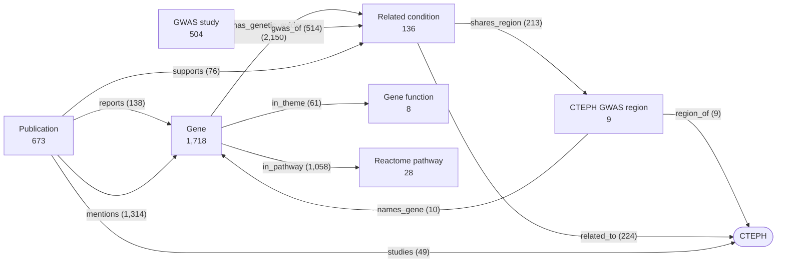

# CTEPH knowledge graph

A dated, reproducible knowledge graph of chronic thromboembolic pulmonary hypertension (CTEPH, [`EFO_0022954`](https://platform.opentargets.org/disease/EFO_0022954)). It covers the genes with genetic evidence for CTEPH, the genetic studies behind them, the conditions related to CTEPH, and the genetics those conditions share with it.

The graph is built from external knowledge only: the Open Targets Platform, the published CTEPH GWAS (Liley et al., 2024), PubMed and Europe PMC. It was built as background for interpreting the signals of a CTEPH whole-genome sequencing study, and none of that study's results enter the graph. Each run writes one snapshot, named by its fetch date. Every choice (threshold, list, grouping, rule) is recorded with its value and its basis, and every statement links to its publication or database record.

**Current snapshot: [2026-10-16](results/snapshots/2026-10-16/README.md)**: Open Targets 26.09; PubMed searched up to 2026-10-16; every publication checked in PubMed on 2026-10-17.

| Viewer (offline HTML) | Workbook | Knowledge base | Graph and SQLite | Slides |
|---|---|---|---|---|
| [`cteph_knowledge_graph.html`](results/snapshots/2026-10-16/cteph_knowledge_graph.html) | [`.xlsx`](results/snapshots/2026-10-16/cteph_knowledge_graph_2026-10-16.xlsx) | [`08.knowledge`](results/snapshots/2026-10-16/08.knowledge/cteph_knowledge_graph.md) | [`05.graph`](results/snapshots/2026-10-16/05.graph/README.md) | [`.pptx`](deck/cteph_knowledge_graph.pptx) · [PDF](deck/cteph_knowledge_graph.preview.pdf) |

**Contents**
- [Key results](#key-results-snapshot-2026-10-16)
  1. [CTEPH genes and the strength of their evidence](#1-cteph-genes-and-the-strength-of-their-evidence)
  2. [The published CTEPH GWAS regions](#2-the-published-cteph-gwas-regions)
  3. [What the genetic studies of CTEPH report](#3-what-the-genetic-studies-of-cteph-report)
  4. [The genetic studies](#4-the-genetic-studies)
  5. [Conditions related to CTEPH](#5-conditions-related-to-cteph)
  6. [CTEPH GWAS regions shared with related conditions](#6-cteph-gwas-regions-shared-with-related-conditions)
  7. [Genes shared by CTEPH and related conditions](#7-genes-shared-by-cteph-and-related-conditions)
  8. [Genetics of the related conditions, mechanisms and East Asian evidence](#8-genetics-of-the-related-conditions-mechanisms-and-east-asian-evidence)
  9. [Curation](#9-curation)
  10. [Caveats](#10-caveats)
- [The graph](#the-graph) · [Open the snapshot](#open-the-snapshot) · [How it is built](#how-it-is-built) · [Requirements](#requirements) · [Run](#run) · [Update the configuration](#update-the-configuration) · [Repository layout](#repository-layout) · [Data sources and reuse](#data-sources-and-reuse)

## Key results (snapshot 2026-10-16)

The workbook, the knowledge base and the viewer answer twelve questions in four parts:
- **A. CTEPH genetics:** genes and their evidence; what each study reports; the studies and their methods.
- **B. Related conditions:** which conditions and why; shared GWAS regions; shared genes; their own genetics.
- **C. Context:** mechanisms; East Asian and Japanese evidence.
- **D. Provenance:** curation; the basis of every choice; changes between snapshots.

The sections below summarize the answers for this snapshot. Each one names the workbook sheet and the knowledge-base section that hold its evidence.

### 1. CTEPH genes and the strength of their evidence


*Evidence level (rows, strongest first) by function (columns) of the 67 genes studied genetically in CTEPH. Workbook sheets 1–2; knowledge base section 2.*

Each gene takes the strongest level that applies:

| Level | Code | Rule | Genes | Which |
|---|---|---|---:|---|
| 1 | G | genome-wide significant in the CTEPH GWAS | 5 | *ABO*, *FGG*, *F11*, *MYH7B*, *HLA-DRA* |
| 2 | G\* | genome-wide significant only after leveraging pulmonary embolism | 5 | *F2*, *TSPAN15*, *SLC44A2*, *F5*, *NME7* |
| 3 | | associated with CTEPH in two or more studies | 3 | *FGA*, *HLA-B*, *HLA-DPB1* |
| 4 | | associated with CTEPH in one study | 9 | *STAB2*, *SERPINE1*, *CLEC7A*, *ETS1*, *FGR*, *NFKBIL1*, *TNFSF13B*, *JAK2*, *LRP1* |
| 5 | | variant identified, no association test | 31 | e.g. *VWF*, *ADAMTS13*, *SERPINC1*, *PROC*, *PROS1*, *TET2*, *DNMT3A*, *BMPR2*, *ACVRL1*, *SOX17* |
| 6 | | tested, not associated | 11 | e.g. *F8*, *MTHFR*, *ACE*, *NOS3*, *CYP2C9*, *VKORC1* |
| 7 | | other result only | 3 | *MIR759*, *GNB3*, *SLC6A4* |

- 53 of the 67 genes have a positive result (levels 1–5).
- Levels 1–2 come from the nine regions in Table 1 of Liley et al. (2024). Levels 3–7 come from 49 genetic studies of CTEPH in PubMed.
- Levels 3–6 count only findings about CTEPH itself. An association with an outcome among patients is kept and marked but does not raise a gene's level. For example, *ACE* I/D and *GNB3* C825T were associated with survival, walking distance or clinical worsening; *ACE* sits at level 6 and *GNB3* at level 7.
- The genes fall into nine functions:
  - fibrinogen;
  - the determinants of ABO, VWF, FVIII and FXI levels;
  - thrombophilia and hemostasis;
  - HLA and immunity;
  - clonal hematopoiesis, MPN and platelets;
  - PAH genes;
  - endothelium and vascular tone;
  - pharmacogenetics;
  - other genes.

  Each function has a cited basis in sheet 11 of the workbook.

### 2. The published CTEPH GWAS regions

The CTEPH GWAS (Liley et al., 2024) analyzed 1,907 European cases and 10,363 controls. Open Targets holds no summary statistics for it. It holds 7 of the 9 lead variants and a CTEPH credible set at 3 regions (*ABO*, *FGG*, *F11*).

| Region | Code | Lead variant | P (meta-analysis) | V (with PE) | OR | In Open Targets | Conditions sharing it |
|---|---|---|---|---|---:|---|---:|
| *ABO* | G | rs687289 | 6.8 × 10⁻²⁷ | 6.8 × 10⁻²⁷ | 1.8 | credible set | 44 |
| *FGG* | G | rs7659024 | 9.0 × 10⁻¹⁷ | 3.5 × 10⁻²³ | 1.6 | credible set | 30 |
| *F11* | G | rs2289252 | 7.7 × 10⁻⁹ | 3.0 × 10⁻¹⁵ | 1.3 | credible set | 31 |
| *MYH7B* | G | rs745849 | 3.4 × 10⁻⁸ | 9.7 × 10⁻⁸ | 0.76 | lead variant only | 8 |
| *HLA-DRA* | G | rs17202899 | 4.7 × 10⁻⁸ | 9.2 × 10⁻⁷ | 1.6 | not held | — |
| *F2* | G\* | rs149903077 | 7.9 × 10⁻⁸ | 3.0 × 10⁻¹⁴ | 3.3 | lead variant only | 34 |
| *TSPAN15* | G\* | rs78677622 | 1.5 × 10⁻⁶ | 6.0 × 10⁻¹³ | 0.70 | lead variant only | 29 |
| *SLC44A2* | G\* | rs2288904 | 8.3 × 10⁻⁶ | 9.3 × 10⁻¹¹ | 0.76 | lead variant only | 37 |
| *F5*/*NME7* | G\* | rs796548658 | 1.5 × 10⁻⁴ | 7.2 × 10⁻¹⁰ | 1.6 | not held | — |

The genes are named as in the publication. At the *FGG* region, the top locus-to-gene gene of Open Targets is *FGA* (score 0.44); it is shown beside the region but does not name it. V is the conditional false discovery rate of the co-analysis with pulmonary embolism, the basis of G\*. Workbook sheet 5 and knowledge base section 2.1 hold the full table.

### 3. What the genetic studies of CTEPH report


*The 18 genes reported by two or more genetic studies of CTEPH, by result and grouped by function. Workbook sheet 2; knowledge base section 2.2.*

**Fibrinogen.** *FGA* is the most replicated gene outside the GWAS: it is associated in four studies.
- Thr312Ala (rs6050) in the United Kingdom (Suntharalingam 2008), China (Li 2013) and Turkey (Çörtük 2023);
- a 3′ UTR insertion in Japan (Chen 2010).

It was not associated in one study (Bereczky 2025).

**HLA in Japanese CTEPH.** *HLA-B\*52:01* (40% vs 24%) and *HLA-DPB1\*02:02* (19% vs 6%) are more frequent in Japanese patients (Tanabe 2005). They are associated with CTEPH without deep vein thrombosis, together with *NFKBIL1* (Kominami 2009). Two further Japanese studies relate *HLA-B\*52:01* to the clinical phenotype among patients; these findings are kept but do not count toward the evidence level.

**Classic thrombophilia variants.**
- *F5* is associated in two studies (factor V Leiden in one, the *F5*/*NME7* region of the GWAS in the other) and not associated in five.
- *F2* is associated in two (prothrombin G20210A in one, the GWAS region in the other) and not associated in three.
- Most other reports are carriers identified without a test.

**Clonal and myeloproliferative variants.** *JAK2* V617F was enriched in one study: 3 of 40 patients carried it, each with a myeloproliferative neoplasm (Eichstaedt 2020). Five further studies identified *JAK2* variants (V617F in four). Clonal-hematopoiesis variants were found in 9.4% of Chinese patients (Liu 2024) and in 20.1% of Japanese patients (Momoi 2024).

**PAH genes.** Rare *BMPR2* variants were identified in three studies and not associated in two. Other PAH genes (*ACVRL1*, *ENG*, *GDF2*, *SOX17*) were identified in sequencing studies without an association test.

### 4. The genetic studies


*Every genetic study of CTEPH kept by the curation, by year and design class, colored by place and sized by cases; the genome-wide studies are labeled. Workbook sheet 3; knowledge base section 3.*

**Selection.** 471 PubMed records were screened:
- 373 were removed by deterministic rules;
- 98 were read by a language model;
- 51 genetic studies were extracted, and 49 remain after the curation, with 138 findings.

Every extracted gene, variant, number and quote was checked against its source text, and 36 items that failed were dropped.

| Design class (one per study) | Studies | Place (first author's institution) | Studies |
|---|---:|---|---:|
| Candidate-gene association | 18 | Japan | 15 |
| Case reports | 11 | China | 11 |
| Exome and gene-panel sequencing | 9 | Europe | 11 |
| Genome-wide (GWAS, genome sequencing, Mendelian randomization) | 5 | North America | 3 |
| HLA typing | 4 | Other (Turkey, Iran, India, Argentina) | 7 |
| Clonal hematopoiesis and somatic variants | 2 | Not known | 2 |

- **Size.** Most studies are small: the median is 50 cases where the abstract states it, with a range of 1–1,970.
- **Methods.** The methods of each study (platform, sequencing, quality control, statistics, covariates, multiple testing) were taken from the open-access Methods section for 19 studies and from the abstract for 30.

### 5. Conditions related to CTEPH


*CTEPH at the center, its related conditions by category.*
- Line style shows the kind of evidence.
- Node size shows the amount of evidence.
- A red outline marks a condition sharing two or more CTEPH GWAS regions.
- The 77 traits that share only a single region (32 of them only the pleiotropic *ABO* region) are drawn as one gray node.

*Workbook sheet 4; knowledge base section 4.*

136 conditions are related to CTEPH. They enter through four kinds of evidence (a condition can have several):

| Evidence | Conditions |
|---|---:|
| Clinical evidence: a sentence of a guideline or study, quoted verbatim and checked against its PubMed abstract at every build (76 quotes from 54 publications) | 27 |
| The disease ontology | 11 |
| Colocalization with a CTEPH credible set | 67 |
| Lead-variant overlap | 70 |

| Category | Conditions | Examples |
|---|---:|---|
| Precursor / spectrum | 4 | venous thromboembolism, deep vein thrombosis, pulmonary embolism, CTEPD |
| Risk factor | 5 | inherited thrombophilia, antiphospholipid syndrome, splenectomy, non-O blood group, intravascular devices |
| Comorbidity | 9 | malignancy, hypothyroidism, inflammatory bowel disease, myeloproliferative neoplasms, clonal hematopoiesis |
| Intermediate trait | 8 | fibrinogen, VWF, factor VIII and factor XI levels, D-dimer, platelets |
| PH group | 11 | pulmonary arterial hypertension and its subtypes, PVOD/PCH |
| Shared genetic signal only | 99 | thromboembolism, thrombophlebitis, ischemic stroke, coagulation traits |

**What the clinical evidence says.**
- **After pulmonary embolism.** CTEPH follows acute pulmonary embolism in about 0.6% of all patients and 3.2% of survivors (Ende-Verhaar 2017, a meta-analysis of 16 studies). In Japan, 2.3% of patients are diagnosed with CTEPH within three years (Ikeda 2024).
- **Against non-thromboembolic PH controls,** the classic risk factors (Bonderman 2009) include:
  - previous VTE (OR 4.5) and recurrent VTE (OR 14.5);
  - non-O blood group (OR 2.1);
  - lupus anticoagulant / antiphospholipid antibodies (OR 4.2);
  - thyroid replacement (OR 6.1);
  - malignancy (OR 3.8);
  - ventriculoatrial shunts and infected pacemakers (OR 76).
- **Against pulmonary embolism survivors,** most of these factors were not enriched; only splenectomy and non-O blood group showed a trend (Dodson 2022). The graph keeps such contrary results.

### 6. CTEPH GWAS regions shared with related conditions


*Conditions sharing two or more CTEPH regions, and clinically related conditions sharing one. Filled dot: colocalization with the CTEPH credible set (CLPP ≥ 0.01 or H4 ≥ 0.8). Open dot: lead-variant overlap, a weaker kind of evidence. Workbook sheet 5; knowledge base section 5.*

- **How a region can be shared.**
  - Colocalization is possible only at the three regions with a CTEPH credible set (*ABO*, *FGG*, *F11*).
  - Lead-variant overlap (lead-variant PIP ≥ 0.01) is used at four more regions (*MYH7B*, *F2*, *TSPAN15*, *SLC44A2*).
  - *HLA-DRA* and *F5*/*NME7* cannot be assessed, because their lead variants are not in Open Targets.
- **Seven traits share six of the seven assessable regions** (all but *MYH7B*): venous thromboembolism, deep vein thrombosis, pulmonary embolism, VWF level, thromboembolism, thrombophlebitis and phlebitis.
- **Factor VIII level** shares five regions, and **factor XI level** shares four.
- **Thirty conditions share two or more regions.** Seventy-seven traits share only one region, 32 of them only *ABO*. A region shared with a single trait can reflect pleiotropy and is weak evidence of a relation.

### 7. Genes shared by CTEPH and related conditions


*All 67 genes studied genetically in CTEPH (rows, by evidence level) by the 21 related conditions with gene evidence (columns, by category). Cell codes:*
- *G: GWAS; for a related condition, the top locus-to-gene gene with a score of at least 0.5.*
- *C: curated gene–disease evidence.*
- *L: a positive finding in a genetic study of CTEPH.*

*Workbook sheet 6; knowledge base section 6.*

- **Shared genes.** 41 of the 67 CTEPH genes also have GWAS or curated evidence in at least one related condition:
  - *ABO* and *F5* in nine;
  - *F11*, *FGG* and *TSPAN15* in eight;
  - *JAK2* in seven: myeloproliferative neoplasm, polycythemia vera, essential thrombocythemia, clonal hematopoiesis, inflammatory bowel disease, DVT and VTE.
- **Genes specific to CTEPH.** 26 genes appear only for CTEPH in this map, among them:
  - *HLA-DRA* and *MYH7B* from the GWAS;
  - *HLA-B* and *HLA-DPB1* from the Japanese studies.
- ***F8*** was not associated with CTEPH in its one study, yet it is a GWAS gene of venous thromboembolism, deep vein thrombosis and pulmonary embolism.
- **Genes not yet studied in CTEPH.** 115 genes that no genetic study of CTEPH has examined have genetic evidence in three or more related conditions. The most widely shared are *SH2B3* and *PLCG2* (eight conditions each), and *PROCR*, *APOE* and *GRK5* (seven each).

### 8. Genetics of the related conditions, mechanisms and East Asian evidence

**Genetics of the related conditions** (workbook sheet 7):
- 514 GWAS studies (53 with a mostly East Asian sample; median sample size 205,219);
- 8,422 credible sets with their locus-to-gene genes;
- 600 curated gene–condition links from ClinGen, PanelApp, Orphanet, ClinVar, UniProt, Gene2Phenotype and gene burden.

**Mechanisms** (workbook sheet 8):
- 382 text-mined CTEPH targets keep their literature, with 1,314 target–publication links, each with its source sentences.
- The targets are grouped by Reactome top-level pathway. The largest groups are signal transduction (169 targets), the immune system (149), disease (118) and hemostasis (85).
- 16 summaries generated by a language model are each checked against their source records.

**East Asian evidence** (workbook sheet 9):
- 26 genetic studies of CTEPH come from East Asia (15 from Japan, 11 from China);
- 10 items of clinical evidence come from East Asian populations;
- 53 GWAS of related conditions have a mostly East Asian sample.

### 9. Curation

Deterministic rules ([`config/curation.yaml`](config/curation.yaml)) decide what the graph holds, and every rule applied is logged (workbook sheet 10; knowledge base section 10). No rule calls a language model.

| Rule | This snapshot |
|---|---|
| Publication status | All 2,151 publications the graph uses were checked in PubMed. Retracted articles and conference material are not part of the graph. 16 are flagged and kept (15 preprints, 1 erratum). |
| Place of a study | The country of the first author's institution, from PubMed or else Europe PMC; 47 of 49 studies are placed. |
| Variant names | One name per variant, with its dbSNP rsID where established. 45 findings carry a common name, for example factor V Leiden for "FVL", "1691G>A" and "factor V leidan". |
| What a finding is about | 15 findings are not about CTEPH itself: 11 concern a phenotype or outcome within CTEPH, 2 another trait with CTEPH as the exposure, 1 a functional experiment and 1 a background statement. |
| Text-mined links | 30 gene–word corrections drop 101 links mapped to the wrong gene. The largest is sGC (soluble guanylate cyclase) mapped to *SGCB*, in 51 publications. |

### 10. Caveats

- **Association, not causation.** A relation to CTEPH is evidence of association (clinical, ontology or shared genetic signal), not of causation. Many classic risk factors were found against non-thromboembolic PH controls.
- **G\* regions** are genome-wide significant only when the similarity with pulmonary embolism is leveraged, so part of their signal is that of pulmonary embolism.
- **Lead-variant overlap** treats the CTEPH lead variant as a stand-in for an unfine-mapped signal. It bounds the colocalization probability only if that variant is causal.
- **Locus-to-gene scores** are predictions of the causal gene, not proof.
- **The ladder counts studies, not independent samples;** some studies share cases.
- **The language-model extraction** of the literature was checked item by item against the source text. Studies behind paywalls contribute their abstract only.
- **Text mining** may still hold wrong gene mappings that were not found. The matched words are listed with every link.

## The graph



The graph has 3,077 nodes of 7 types and 5,816 edges of 12 types. CTEPH is itself a condition node, alongside the 136 related conditions. Each edge keeps its evidence: the statement or quote, the result and variant, and the PMID or database record.

The graph is written three ways:
- node and edge tables, one per type;
- node-link `graph.json`;
- a SQLite database that also holds every curated and long table.

The schema, identifiers and example SQL are in [`05.graph/README.md`](results/snapshots/2026-10-16/05.graph/README.md).

## Open the snapshot

| To | Open |
|---|---|
| browse the graph: search, a page per gene, condition, region and study, every source linked | [`cteph_knowledge_graph.html`](results/snapshots/2026-10-16/cteph_knowledge_graph.html). Download it, or clone the repository, and open it in any browser; it works offline. GitHub shows only its source. |
| read the evidence by question | [`cteph_knowledge_graph_2026-10-16.xlsx`](results/snapshots/2026-10-16/cteph_knowledge_graph_2026-10-16.xlsx) |
| read the knowledge base, with figures | [`08.knowledge/cteph_knowledge_graph.md`](results/snapshots/2026-10-16/08.knowledge/cteph_knowledge_graph.md) |
| see the figures and their catalog | [`09.figures/`](results/snapshots/2026-10-16/09.figures/README.md) |
| query from code | [`05.graph/`](results/snapshots/2026-10-16/05.graph/README.md) |
| see the build and the results as slides | [`deck/cteph_knowledge_graph.pptx`](deck/cteph_knowledge_graph.pptx) (18 slides; [PDF](deck/cteph_knowledge_graph.preview.pdf)) |


*The viewer's page of FGA, with its neighbors and every finding linked to PubMed.*

`results/latest.json` points to the newest snapshot and to each of its products. Its paths are relative to `results/`.

`scripts/kg.py` queries the SQLite file of a snapshot, from the shell or from Python. It needs only the Python standard library.

```bash
python3 scripts/kg.py gene FGG                 # level, function, every finding with its study and sentence, conditions
python3 scripts/kg.py condition "Pulmonary embolism"
python3 scripts/kg.py region ABO
python3 scripts/kg.py publication 20677013
python3 scripts/kg.py studies --place Japan
python3 scripts/kg.py search fibrinogen
python3 scripts/kg.py neighbors HLA-B --edge reports
python3 scripts/kg.py sql "SELECT label, cteph_level FROM node_gene WHERE cteph_level <= 3"
python3 scripts/kg.py --json gene JAK2          # JSON instead of Markdown
```

In Python, with `scripts/` on the path: `from kg import KG; KG().gene('FGG')`.

## How it is built

The pipeline is one line of stages. Each stage writes one numbered folder of the snapshot.

| Stage | Folder | Steps |
|---|---|---|
| sources | `00.raw`, `00.pubmed` | Open Targets (CTEPH; each related condition); PubMed (the genetic-study search, the seed); Europe PMC Methods texts; the PubMed record of every publication the graph uses |
| evidence | `01.conditions`, `02.literature` | the related conditions and their evidence; the genetic studies of CTEPH, extracted by an isolated language model, with every item checked against its source text |
| curation | `03.curated` | publications left out (retracted, conference material) or flagged; the place and design class of each study; one name per variant; what each finding is about; text-mined links mapped to the wrong gene removed. Deterministic rules ([`config/curation.yaml`](config/curation.yaml)); every rule applied is logged |
| tables | `04.tables` | the long tables and the evidence ladder |
| graph | `05.graph` | typed nodes and edges, `graph.json`, a SQLite database, the schema |
| products | `06`–`09`, top level | grounded summaries, changes since the previous snapshot, the knowledge base, figures; the workbook; the viewer; the index (`README.md`) |

Language-model answers (screening, extraction and summaries) are cached in `cache/llm/`. A later snapshot sends only new PubMed records to the model.

Every choice has an entry in [`config/choices.yaml`](config/choices.yaml) with:
- its value, read from the run;
- its basis type: source, data check, design or user;
- its basis, with references.

Sheet 11 of the workbook and section 11 of the knowledge base print the choices with each snapshot, and `verify.sh` checks them. The methods are in [docs/METHODS.md](docs/METHODS.md).

## Requirements

- Nextflow (DSL2, strict syntax; tested with 26.04.4).
- Python 3 (tested with 3.12) with the packages in [`requirements.txt`](requirements.txt) (pandas, numpy, matplotlib, PyYAML, XlsxWriter, openpyxl).
- Internet access from the launch host for:
  - the Open Targets GraphQL API;
  - NCBI E-utilities;
  - the Europe PMC REST API.

  Every process runs locally on the launch host.
- The `claude` CLI (Claude Code; tested with 2.1.220). It is used only for records not yet in `cache/llm/`. `--LlmOffline true` never calls it.
- For the deck only: Node.js with `pptxgenjs`, and LibreOffice for the PDF preview.

The site paths of the tools are the defaults in the site configuration at the top of `cteph_knowledge_graph.nf`. Override them on the command line:
- `--python <python3 with the packages>`;
- `--claude <claude CLI>`.

## Run

```bash
git clone https://github.com/ZhaoTie-re/cteph_knowledge_graph.git && cd cteph_knowledge_graph
./verify.sh                                     # pre-flight, sections 1-5 (NO_LLM=1 skips the one model probe)
nextflow run cteph_knowledge_graph.nf --FetchDate $(date +%F) -ansi-log false
./verify.sh                                     # post-run, sections 6-10, on the newest snapshot
```

- **`--FetchDate`** names the snapshot. A new date queries Open Targets and PubMed again, writes `results/snapshots/<date>/`, compares it with the previous snapshot (`07.changes`), and moves `results/latest.json` to it.
- **`--Rebuild true --FetchDate <date>`** re-derives an existing snapshot from its saved sources (00–02) after a change to the curation, tables or products. Nothing is fetched again, except the PubMed publication records once if they are missing, and no model is called.
- **`--LlmOffline true`** uses cached model answers only.
- **A smoke run** adds `--LlmLimit 10 --MaxThemes 2 --results_root <scratch>`.
- **`nextflow lint cteph_knowledge_graph.nf nextflow.config`** is the safe syntax check. `nextflow run --help` would launch the pipeline.
- **On a cluster whose compute nodes have no internet access** (as on the one where this was built), launch from the login node. `verify.sh` puts the site's Nextflow environment on `PATH` when it exists; set `NXF_BIN=<dir>` to use another one.

## Update the configuration

| File | What it holds | Notes |
|---|---|---|
| [`config/curation.yaml`](config/curation.yaml) | exclusion rules, variant names, findings not about CTEPH, text-mining corrections, design classes, country names | An entry that matches nothing stops the build. A new finding with outcome words is logged for review in `03.curated/curation_log.tsv`. |
| [`config/related_conditions.yaml`](config/related_conditions.yaml) | the curated clinical relations | Each item needs a PMID, a verbatim quote from its title or abstract, and a one-line statement. The build stops if a quote is not in the abstract, or if it cites a publication the curation leaves out. |
| [`config/gene_themes.yaml`](config/gene_themes.yaml) | the functions (gene themes) | Each theme needs a basis and references. |
| [`config/cteph_gwas.yaml`](config/cteph_gwas.yaml) | the published CTEPH regions | Copied from Table 1 of the publication. |
| [`config/choices.yaml`](config/choices.yaml) | every choice and its basis | A new parameter or rule needs an entry, or `verify.sh` fails. |

## Repository layout

| Path | Content |
|---|---|
| `cteph_knowledge_graph.nf`, `nextflow.config` | the pipeline and its execution profile |
| `verify.sh` | pre-flight and post-run checks (read-only) |
| `config/` | the curated inputs and rules (above) |
| `scripts/` | the step scripts (below), the query tool `kg.py`, and `plot_style.py` (the figure style, vendored) |
| `docs/` | [METHODS.md](docs/METHODS.md) (how each item is derived), [OUTPUTS.md](docs/OUTPUTS.md) (every file of a snapshot), [STUDY_NOTES.md](docs/STUDY_NOTES.md) (design decisions and their history) |
| `deck/` | the slides on the build and the current snapshot, generated from the snapshot ([deck/README.md](deck/README.md)) |
| `results/` | `latest.json` and `snapshots/<FetchDate>/` |
| `cache/llm/` | the cached language-model answers, kept across snapshots |

The scripts, by stage:

| Stage | Scripts |
|---|---|
| sources | `fetch.py` (Open Targets; Ensembl for lead variants), `pubmed.py` (PubMed, Europe PMC), `publications.py` (the PubMed record of every publication) |
| evidence | `resolve.py` (conditions and evidence); `extract_genetics.py` and `llm.py` (literature screening and extraction) |
| curation | `curate.py` |
| tables and graph | `tidy_graph.py`, `build_graph.py` |
| products | `summarise.py`, `diff_snapshots.py`, `draw_figures.py`, `build_knowledge.py`, `write_table.py`, `build_viewer.py`, `manifest.py` |
| shared | `ot_common.py` |

## Data sources and reuse

- **Open Targets Platform**, release 26.09. The data are open (CC0 1.0).
- **PubMed** (NCBI E-utilities) and **Europe PMC**. A snapshot's `00.pubmed/` keeps the records as fetched, so that it can be rebuilt. The abstracts and full texts remain under their publishers' copyright or their articles' licenses. The graph itself keeps short source sentences and verbatim quotes as evidence, each linked to its PubMed record.
- **The published CTEPH GWAS regions** are from Liley, J., Newnham, M., Bleda, M., et al. (2024). Shared and distinct genomics of chronic thromboembolic pulmonary hypertension and pulmonary embolism. *American Journal of Respiratory and Critical Care Medicine, 209*(12), 1477–1485.

## Author

Zhao Tie ([@ZhaoTie-re](https://github.com/ZhaoTie-re)).
