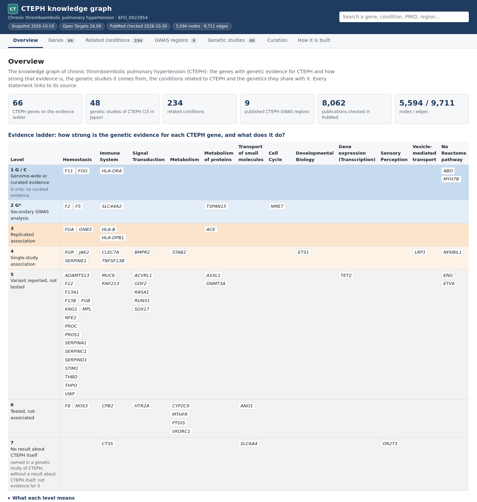
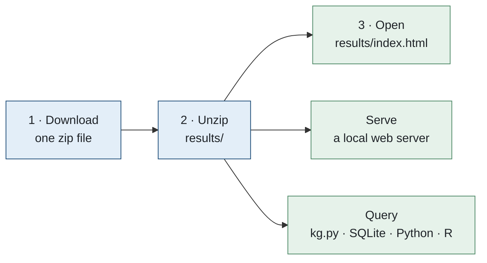
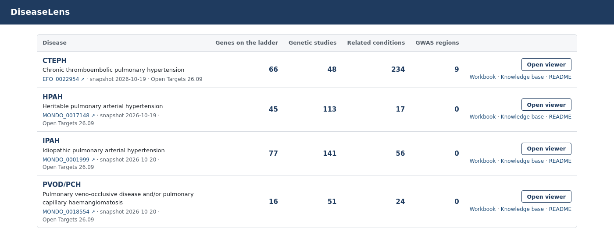
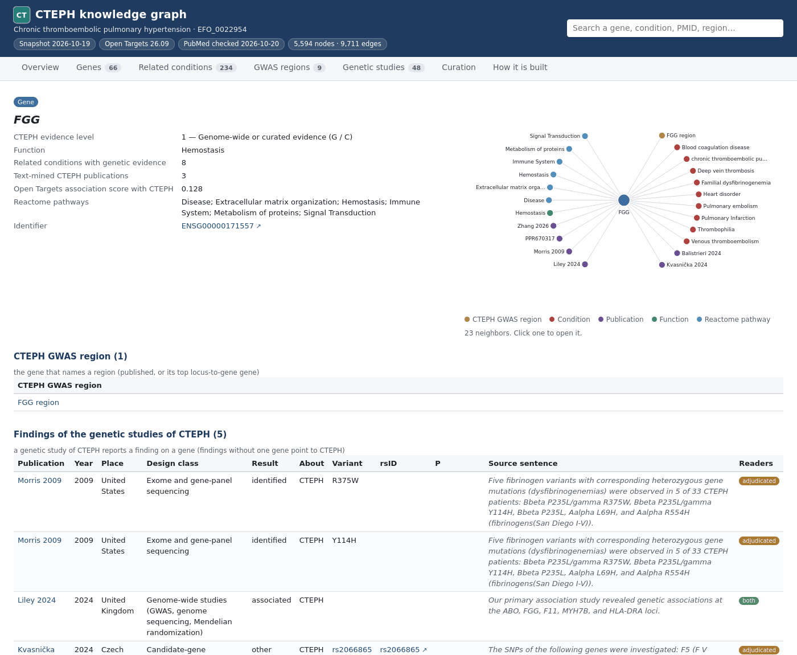
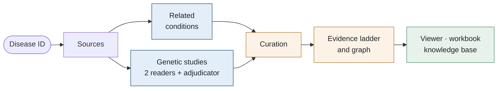

# DiseaseLens

**Dated, traceable knowledge graphs of the genetics of a disease and of the conditions related to it, for any
disease in Open Targets.**

DiseaseLens starts from an Open Targets disease ID. It gathers what public sources hold on the disease's genetics,
has two language models read the genetic literature independently (a third adjudicates where they differ), checks
every item against its source text, and writes one dated snapshot per disease: an offline viewer, a workbook
organized by question, a knowledge base with figures, and the graph as tables, JSON and SQLite.

This repository holds the pipeline. The knowledge graphs already built with it can be downloaded and opened on your
own computer, offline (see below).



| Document | For |
|---|---|
| This README | getting the prebuilt knowledge graphs, opening and querying them |
| [docs/METHODS.md](docs/METHODS.md) | how a knowledge graph is built, step by step, with every rule |
| [docs/USAGE.md](docs/USAGE.md) | building the knowledge graph of another disease |

## Prebuilt knowledge graphs

| Disease | Open Targets ID | Snapshot | Genes on the evidence ladder | Genetic studies | Related conditions | GWAS regions | Nodes / edges |
|---|---|---|---:|---:|---:|---:|---:|
| **CTEPH**, chronic thromboembolic pulmonary hypertension | [EFO_0022954](https://platform.opentargets.org/disease/EFO_0022954) | 2026-10-19 | 66 | 48 | 234 | 9 | 5,594 / 9,711 |
| **HPAH**, heritable pulmonary arterial hypertension | [MONDO_0017148](https://platform.opentargets.org/disease/MONDO_0017148) | 2026-10-19 | 45 | 113 | 17 | 0 | 1,537 / 3,671 |
| **IPAH**, idiopathic pulmonary arterial hypertension | [MONDO_0001999](https://platform.opentargets.org/disease/MONDO_0001999) | 2026-10-20 | 77 | 141 | 56 | 0 | 3,691 / 7,669 |
| **PVOD/PCH**, pulmonary veno-occlusive disease and/or pulmonary capillary haemangiomatosis | [MONDO_0018554](https://platform.opentargets.org/disease/MONDO_0018554) | 2026-10-20 | 16 | 51 | 24 | 0 | 1,386 / 2,008 |

All four use Open Targets release 26.09. A disease with no GWAS in Open Targets has no GWAS region; its genes come
from curated gene–disease evidence and the genetic literature.

## Get the knowledge graphs on your computer



### 1. Download

The graphs are published as one file, `diseaselens-results.zip` (57 MB; 215 MB unpacked), attached to the
[latest release](https://github.com/ZhaoTie-re/DiseaseLens/releases/latest).

macOS or Linux:

```bash
curl -LO https://github.com/ZhaoTie-re/DiseaseLens/releases/latest/download/diseaselens-results.zip
curl -LO https://github.com/ZhaoTie-re/DiseaseLens/releases/latest/download/diseaselens-results.zip.sha256
shasum -a 256 -c diseaselens-results.zip.sha256      # Linux: sha256sum -c diseaselens-results.zip.sha256
unzip diseaselens-results.zip                         # creates results/
```

Windows (PowerShell):

```powershell
Invoke-WebRequest https://github.com/ZhaoTie-re/DiseaseLens/releases/latest/download/diseaselens-results.zip -OutFile diseaselens-results.zip
Expand-Archive diseaselens-results.zip -DestinationPath .
```

With the GitHub CLI: `gh release download --repo ZhaoTie-re/DiseaseLens --pattern 'diseaselens-results.zip*'`.

### 2. Open

Open `results/index.html` in any browser: double-click it, or `open results/index.html` (macOS),
`xdg-open results/index.html` (Linux), `start results\index.html` (Windows). Nothing needs to be installed and no
network is needed: every page is a self-contained HTML file, and every link is relative, so the folder can be moved,
copied or shared as it is.



The index lists every disease. **Open viewer** opens a disease's knowledge graph in a new tab; the workbook (Excel,
LibreOffice, WPS), the knowledge base (Markdown) and the snapshot's README are linked beside it.

### 3. Serve them (optional)

To browse the graphs at an address, for example on a lab server, serve the folder with any static web server. With
Python:

```bash
python3 -m http.server 8000 --bind 127.0.0.1 --directory results
# then open http://127.0.0.1:8000/
```

On a remote server, start the same command there and forward the port from your computer:

```bash
ssh -N -L 8000:127.0.0.1:8000 <user>@<server>     # then open http://127.0.0.1:8000/ locally
```

The pages are static files: no database or backend runs. `--bind 127.0.0.1` keeps the server private to the
machine; serve on another address only on a network you trust.

### Query the graph

**With `kg.py`**, the query tool of this repository (standard library only). Clone the repository and unzip the
download inside it, so that the graphs are in its `results/` folder:

```bash
git clone https://github.com/ZhaoTie-re/DiseaseLens.git
cd DiseaseLens
curl -LO https://github.com/ZhaoTie-re/DiseaseLens/releases/latest/download/diseaselens-results.zip
unzip diseaselens-results.zip

python3 scripts/kg.py --disease cteph info                              # the snapshot and its counts
python3 scripts/kg.py --disease cteph gene FGG                          # level, function, findings with sentences
python3 scripts/kg.py --disease cteph condition "pulmonary embolism"    # why it is related, shared genetics
python3 scripts/kg.py --disease cteph studies --place Japan             # genetic studies by place
python3 scripts/kg.py --disease ipah --json gene BMPR2                  # JSON instead of Markdown
python3 scripts/kg.py --disease cteph sql "SELECT label, disease_level, disease_code FROM node_gene WHERE disease_level <= 2 ORDER BY disease_level"
```

`kg.py` reads `results/` of the repository; `--root <folder>` points it at a `results/` folder elsewhere. The
subcommands are `info`, `gene`, `condition`, `region`, `publication`, `studies`, `search`, `neighbors` and `sql`. In
Python: `sys.path.insert(0, "scripts"); from kg import KG; KG(disease="cteph").gene("FGG")`.

**With SQLite.** Each snapshot has one database holding the nodes and edges (`node_<type>`, `edge_<type>`) and every
table of the snapshot:

```bash
sqlite3 results/cteph/snapshots/2026-10-19/05.graph/cteph_knowledge_graph.sqlite \
  "SELECT label, disease_level, disease_code, theme FROM node_gene WHERE disease_level <= 3 ORDER BY disease_level, label;"
```

**With Python** (pandas, NetworkX):

```python
import json, sqlite3
import pandas as pd
import networkx as nx

snap = "results/cteph/snapshots/2026-10-19/05.graph"
db = sqlite3.connect(f"{snap}/cteph_knowledge_graph.sqlite")
genes = pd.read_sql("SELECT label, disease_level, disease_code, theme FROM node_gene "
                    "WHERE disease_level IS NOT NULL ORDER BY disease_level", db)

with open(f"{snap}/graph.json") as f:
    data = json.load(f)
try:
    G = nx.node_link_graph(data, edges="edges")    # NetworkX 3.4 and later
except TypeError:
    G = nx.node_link_graph(data, link="edges")     # earlier versions
print(G.number_of_nodes(), G.number_of_edges())
```

**With R** (base R, the TSV tables):

```r
snap  <- "results/cteph/snapshots/2026-10-19/05.graph"
genes <- read.delim(file.path(snap, "nodes_gene.tsv"))
edges <- read.delim(file.path(snap, "edges_related_to.tsv"))
subset(genes, !is.na(disease_level) & disease_level <= 2, select = c(label, disease_level, disease_code))
```

Every column of every table is described in the snapshot's `05.graph/README.md`.

### What the download holds

```text
results/
├── index.html, index.json, README.md       the index of every disease
└── <disease>/
    ├── latest.json                         the newest snapshot and the path of each product
    └── snapshots/<date>/
        ├── <disease>_knowledge_graph.html  the viewer
        ├── <disease>_knowledge_graph_<date>.xlsx, ..._summary.xlsx    the workbooks
        ├── 01.conditions/ … 04.tables/     evidence, curation and long tables (TSV)
        ├── 05.graph/                       nodes and edges (TSV), graph.json, SQLite, schema
        ├── 06.summaries/ … 09.figures/     summaries, changes, knowledge base, figures
        └── _run_info/                      the resolved profile and the run manifest
```

Not included are the raw downloads of each build (`00.raw/`, `00.pubmed/`, and the relation search of
`01.relations/`), which hold full PubMed abstracts; everything derived from them, with its source sentences and
PMIDs, is included. They are recreated by running the pipeline ([docs/USAGE.md](docs/USAGE.md)).

## Reading a knowledge graph

Every gene with genetic evidence for the disease is placed on an **evidence ladder** of seven levels, the same for
every disease; a gene takes its strongest level.

| Level | Code | Name | Meaning |
|---|---|---|---|
| 1 | G / C | Genome-wide or curated evidence | in a genome-wide significant GWAS region of the disease (G), or with curated gene–disease evidence (C) |
| 2 | G\* | Secondary GWAS analysis | in a region significant only in a secondary analysis of a published GWAS |
| 3 | | Replicated association | associated with the disease in two or more genetic studies |
| 4 | | Single-study association | associated in one genetic study |
| 5 | | Variant reported, not tested | a variant reported in patients, without an association test |
| 6 | | Tested, not associated | tested and not associated in any study |
| 7 | | No result about the disease itself | named in a genetic study without a result about the disease itself (the reason is given for each gene) |

The viewer has one tab per question: **Overview** (the ladder by gene function), **Genes**, **Related conditions**
(an interactive map: every relation with its evidence, a verbatim quote or a shared GWAS signal), **GWAS regions**,
**Genetic studies** (design, place, sample sizes, methods, findings), **Curation** (what was left out or corrected,
and every disagreement between the two model readers with its decision), and **How it is built**. Every gene,
condition, region and study has its own page, with each edge and its source link. A link from a list opens in a new
tab; the browser tab names the disease first.



## How the graphs are built



- **Sources.** Open Targets (the disease and its ontology, GWAS credible sets, locus-to-gene scores,
  colocalizations, curated gene evidence, text-mined literature), PubMed (genetic studies, clinical relations, the
  record of every publication used) and Europe PMC (Methods sections of open-access full texts). PubMed is searched
  up to the snapshot's date, so a snapshot can be reproduced.
- **GWAS regions** come from a published table, or from the disease's GWAS in Open Targets when the lead variant is
  credible: enough expected copies of its minor allele, a stricter P for rare variants, or replication.
- **Related conditions** enter by clinical evidence (a curated list, or relations read from PubMed with a verbatim
  quote), by the disease ontology, or by a GWAS signal shared with a region of the disease.
- **Genetic studies** are screened by rule, then read by two language models that never see each other's answer; a
  third model decides where they differ. Every gene, variant, number and quote must occur in the source text, or the
  item is dropped.
- **Curation** is deterministic: retracted articles and conference material are left out, each study gets its place
  and design, each variant one name, each finding what it is about, and text-mining errors are removed.
- **Every rule** is a parameter or a configuration file, recorded in each snapshot with its value and basis.

The full methods are in [docs/METHODS.md](docs/METHODS.md).

## Build the graph of another disease

```bash
git clone https://github.com/ZhaoTie-re/DiseaseLens.git && cd DiseaseLens
conda env create -f environment.yml && conda activate diseaselens
cp conf/local.config.example conf/local.config          # choose the language-model backend
python3 scripts/new_disease.py <disease ID>             # e.g. MONDO_0017148; writes diseases/<key>/profile.yaml
nextflow run main.nf -c conf/local.config --diseases <key> --FetchDate $(date +%F)
```

The language models can be the Claude Code CLI, the Anthropic API or any OpenAI-compatible endpoint (three different
models: two readers and an adjudicator). Installing, configuring the models, adding a disease, test runs, options,
outputs and troubleshooting are in [docs/USAGE.md](docs/USAGE.md).

## Repository layout

| Path | Content |
|---|---|
| `main.nf`, `nextflow.config` | the pipeline and its parameters |
| `diseases/<key>/` | one folder per disease: its profile and optional curated files |
| `config/` | shared rules: PubMed searches and pre-screen, curation rules, the choices registry |
| `conf/local.config.example` | your settings (Python, language models), to copy to `conf/local.config` |
| `projects/` | an example project file: several diseases in one run |
| `scripts/` | the steps of the pipeline, `new_disease.py`, and the query tool `kg.py` |
| `verify.sh` | read-only checks before and after a run |
| `docs/` | [METHODS.md](docs/METHODS.md), [USAGE.md](docs/USAGE.md), images |

Results, the model cache and run records are written outside version control (`results/`, `cache/`, `work/`).

## Citing and reusing

Cite a snapshot as: DiseaseLens, `<disease>` knowledge graph, snapshot `<date>`, Open Targets `<release>`,
https://github.com/ZhaoTie-re/DiseaseLens. The cover sheet of each workbook gives the exact line.

Open Targets data are open (CC0 1.0). Abstracts and full texts remain under their publishers' copyright or their
articles' licenses; the graphs keep short source sentences as evidence, each linked to its PubMed record.

## Author

Zhao Tie ([@ZhaoTie-re](https://github.com/ZhaoTie-re)).
