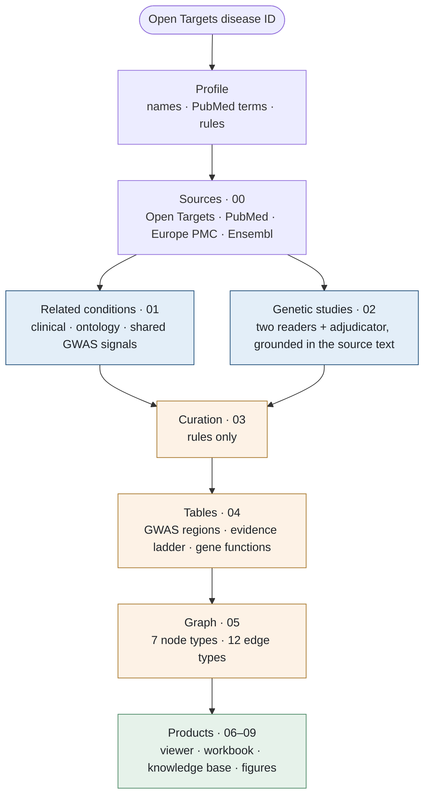
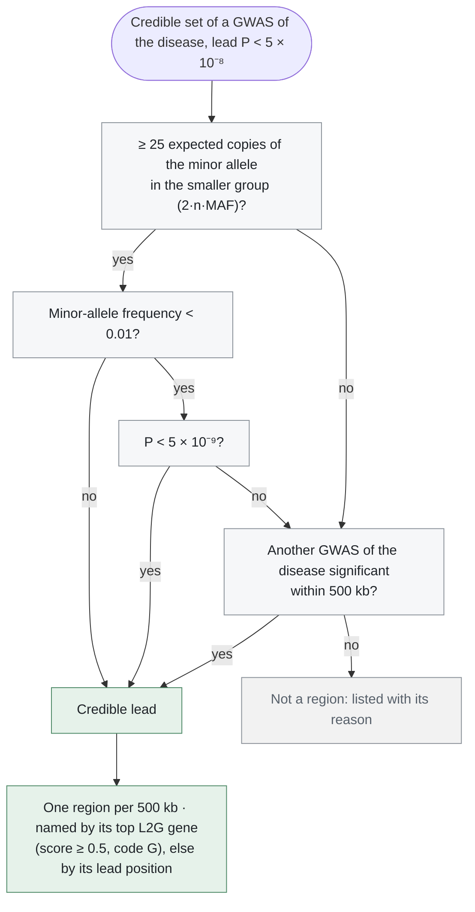
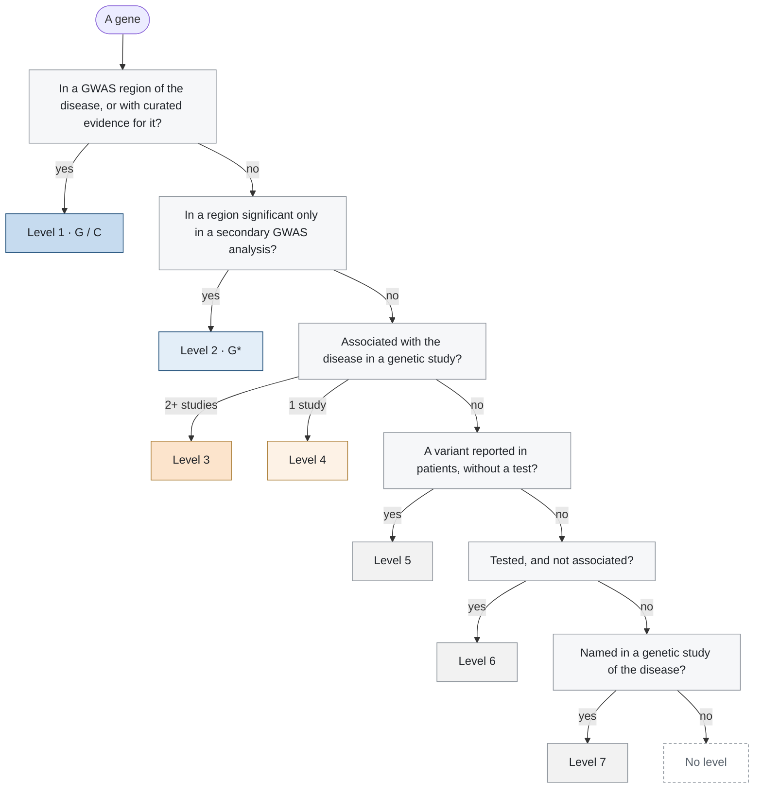
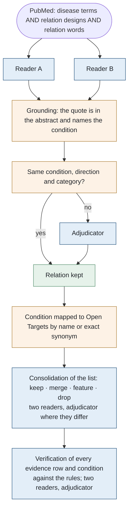
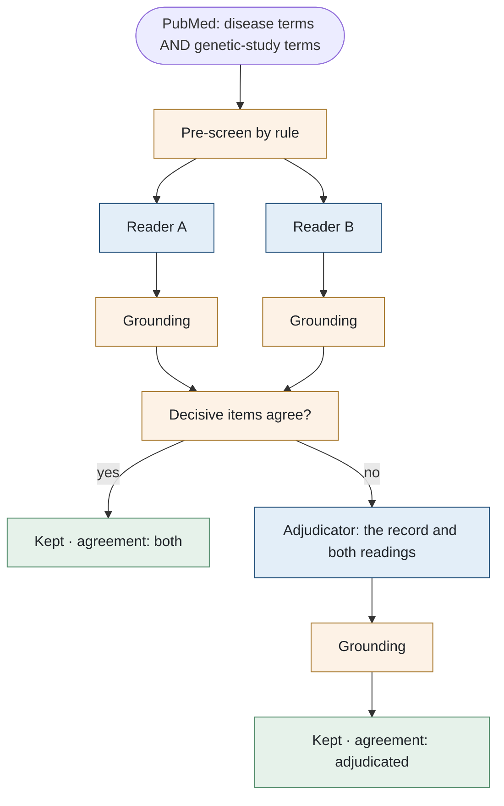
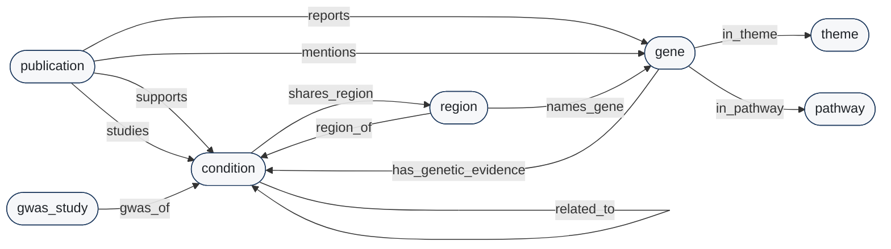

# Methods: how DiseaseLens builds a knowledge graph

This document describes every step from an Open Targets disease ID to the finished knowledge graph and its products.
The steps are the same for every disease. A disease enters only through its profile (section 3); everything else
is a shared rule. Examples come from the four graphs built with the repository: CTEPH (`EFO_0022954`), HPAH
(`MONDO_0017148`), IPAH (`MONDO_0001999`) and PVOD/PCH (`MONDO_0018554`).

How to run the pipeline is in [USAGE.md](USAGE.md); how to obtain the finished graphs is in the
[README](../README.md).

**Contents**

1. [Principles](#1-principles)
2. [The build at a glance](#2-the-build-at-a-glance)
3. [The disease profile](#3-the-disease-profile)
4. [Sources and the snapshot](#4-sources-and-the-snapshot)
5. [The genetics of the disease](#5-the-genetics-of-the-disease)
6. [Related conditions](#6-related-conditions)
7. [The genetics of the related conditions](#7-the-genetics-of-the-related-conditions)
8. [The genetic studies, read by two independent models](#8-the-genetic-studies-read-by-two-independent-models)
9. [Curation](#9-curation)
10. [Summaries](#10-summaries)
11. [The graph](#11-the-graph)
12. [Products](#12-products)
13. [The choices registry](#13-the-choices-registry)
14. [Snapshots over time](#14-snapshots-over-time)
15. [Limitations](#15-limitations)
16. [References](#16-references)

## 1. Principles

| Principle | In practice |
|---|---|
| **A disease is an ID, not a name** | The input is an Open Targets disease ID (EFO, MONDO, HP, Orphanet). A name can name several diseases; an ID cannot. |
| **A graph is a dated snapshot** | Every build has a fetch date. PubMed is searched for the records that entered it up to that date, the Open Targets release is recorded, and everything fetched is saved with the snapshot. |
| **Every item is traceable** | Every node and edge keeps its source: a PMID with a verbatim sentence, or an Open Targets record. |
| **Models read; rules decide** | Language models only read text (abstracts, Methods sections) and write summaries. Two models read independently, a third adjudicates, and every answer is checked against its source text by rule. Curation, the evidence ladder and the graph are deterministic. |
| **Every rule is explicit** | Every threshold is a run parameter (`nextflow.config`); every list and pattern is a configuration file (`config/`, `diseases/<key>/`). Each is recorded, with its value and its basis, in the choices registry of the snapshot (section 13). |

## 2. The build at a glance

Blue: steps where language models read text; orange: rule-only steps; green: the products.

Each stage writes one numbered folder of the snapshot (`results/<key>/snapshots/<date>/`):

| Stage | Folder | Scripts | What it does |
|---|---|---|---|
| Profile | `_run_info/` | `profile.py` | Resolves the disease's names, PubMed queries and rules (section 3). |
| Sources | `00.raw/`, `00.pubmed/` | `fetch.py`, `pubmed.py`, `publications.py` | Reads Open Targets, PubMed and Europe PMC, and saves every response (section 4). |
| Related conditions | `01.relations/`, `01.conditions/` | `relations.py`, `resolve.py`, `fetch.py` | Finds the conditions related to the disease and the evidence for each relation, then fetches their genetics (sections 6–7). |
| Genetic studies | `02.literature/` | `extract_genetics.py`, `llm.py` | Screens the genetic literature; two models read each record; disagreements are adjudicated (section 8). |
| Curation | `03.curated/` | `curate.py` | Applies the curation rules: publications left out, places, designs, variant names, what a finding is about, text-mining corrections (section 9). |
| Tables | `04.tables/` | `tidy_graph.py` | Writes the long tables, the GWAS regions, the evidence ladder and the gene functions (section 5). |
| Graph | `05.graph/` | `build_graph.py` | Writes the typed graph as tables, JSON and SQLite (section 11). |
| Products | `06`–`09`, top level | `summarise.py`, `diff_snapshots.py`, `build_knowledge.py`, `draw_figures.py`, `write_table.py`, `build_viewer.py`, `manifest.py` | Summaries, changes since the last snapshot, knowledge base, figures, workbook, viewer and index (sections 10, 12, 14). |

The pipeline is written in Nextflow (DSL2, `main.nf`); several diseases are built side by side in one run.

## 3. The disease profile

`scripts/new_disease.py <ID>` writes `diseases/<key>/profile.yaml` from the Open Targets record of the disease. Only
`id` is required; every other value is derived, and the profile states the rule behind each one.

| Value | Rule |
|---|---|
| **Name** | The Open Targets name. |
| **Short name** | The shortest acronym among the exact synonyms that spells the name: each word gives its first letter, and may give further letters of itself, in order (CTEPH: Chronic ThromboEmbolic Pulmonary Hypertension). Without one: the name itself if it has at most 11 characters; else the initials, marked as made up, used as a label and never searched. At most 11 characters, because workbook sheet names are limited to 31. |
| **PubMed terms** | The name, the exact synonyms, the short name (not one made up), and the names of the entries whose evidence the disease takes (`evidence_also`), in title or abstract. The name is always kept; a name in the database form "A, B" is also searched as "B A". |
| **Terms left out** | A term that Open Targets maps to a gene (PAH is phenylalanine hydroxylase; PPH1 is an alias of BMPR2); a term that names another disease (other than the disease, its descendants and its `evidence_also` entries); an acronym of two characters or fewer; database forms (parentheses, brackets, " - ", NOS). Each is listed in the profile with its reason. |
| **Acronyms** | Searched only together with a word of the name (`HPAH AND (heritable OR pulmonary OR arterial OR hypertension)`). Alone, HPAH also finds human phenylalanine hydroxylase and halogenated polycyclic aromatic hydrocarbons: this rule removed 57 of 331 records from the HPAH search. |
| **`evidence_also`** | For a grouping name ("A and/or B"), the Open Targets entries of its parts whose evidence is read with the disease's own. PVOD/PCH (`MONDO_0018554`) has no literature of its own in Open Targets; the literature of pulmonary veno-occlusive disease is held under `MONDO_0009937`. |

A profile can also set a `scope` (one or two sentences on which studies count as studies of the disease, given to
the readers), the ontology neighbors to use, the categories of related conditions, short labels and
abbreviations, and expected values for the checks. A disease folder can hold curated files, each replacing or
adding to a default:

| File | Replaces or adds | In the four example graphs |
|---|---|---|
| `related_conditions.yaml` | replaces the clinical relations read from PubMed (section 6) | none: all four read their relations from PubMed |
| `gwas_regions.yaml` | replaces the GWAS regions from Open Targets (section 5.1) | CTEPH: the nine regions of Liley et al. (2024), Table 1 |
| `gene_themes.yaml` | replaces Reactome pathways as gene functions (section 5.4) | none: all four use Reactome |
| `curation.yaml` | adds disease-specific curation entries (section 9) | none: all four use the shared rules only |
| `choices.yaml` | adds to, or replaces items of, the choices registry | CTEPH: the basis of its GWAS table |
| `text/<product>.yaml` | adds prose about the disease to the products | none |

The four example graphs are built by the same rules from profiles written from their IDs; the one curated input
among them is CTEPH's published GWAS table, because Open Targets fine-maps only some of its regions.

`profile.py` merges the profile, the disease's files and the shared rules of `config/` (`search.yaml`,
`curation.yaml`, `choices.yaml`) into one `profile.json`, saved in the snapshot (`_run_info/profile.json`) and read
by every later step.

## 4. Sources and the snapshot

| Source | Access | What it gives |
|---|---|---|
| [Open Targets Platform](https://platform.opentargets.org) | GraphQL API | The disease, its ontology and synonyms; its associated targets with datasource scores; text-mined (Europe PMC) and GWAS evidence; GWAS studies, credible sets, locus-to-gene (L2G) scores and colocalizations; curated gene–disease evidence; Reactome pathways of the targets. The same for each related condition. |
| PubMed | NCBI E-utilities (esearch, efetch) | The genetic studies of the disease; the clinical relations (for a disease without a curated list); the record of every publication the graph uses (publication types, comments and corrections such as retractions, affiliations, whether an abstract exists). |
| Europe PMC | REST | The Methods sections of open-access full texts; the first-author affiliation that PubMed lacks. |
| Ensembl | REST (GRCh38) | The position of a published lead variant that the Open Targets search does not index. |

**Reproducibility of the reads.**
- PubMed is searched by Entrez date (the date a record entered PubMed) up to the fetch date, so the same date finds
  the same records later. A search above 9,999 records, the most PubMed returns at once, is split by date. Requests
  are spaced 0.4 s apart. An error PubMed reports stops the run; a query that finds nothing is logged as a warning.
- Every Open Targets list is checked against the count the API reports, and its IDs must be unique. Paged lists are
  not stable where the sort key ties, so a list longer than its first page is re-read in pages of up to 3,000 rows
  until the union of its rows holds them all.
- Requests are retried with exponential backoff on server errors, HTTP 429 and network failures.
- Every response is saved in the snapshot (`00.raw/`, `00.pubmed/`), with the Open Targets release and the date of
  each read.

**Evidence of the disease.** Open Targets evidence is read for the disease together with its ontology descendants,
and with the entries of `evidence_also`.

## 5. The genetics of the disease

### 5.1 GWAS regions

A GWAS region is a genome-wide significant locus of the disease. It comes from one of two places.

**Published regions.** When the profile has a curated table (`gwas_regions.yaml`), its regions are the disease's
regions, each named by the gene the publication names. For each lead variant the pipeline looks up its Open
Targets variant ID (exact rsID match, else the Ensembl GRCh38 alleles checked against Open Targets), a credible set
of the disease at it, and the credible sets of other GWAS that contain it. The table's labels map to codes: CTEPH's
meta-analysis regions (P < 5 × 10⁻⁸) are G; the four regions genome-wide significant only after leveraging pulmonary
embolism (Liley et al., 2024) are G\*.

**Regions from Open Targets.** Without a curated table, the regions are the genome-wide significant credible sets
(lead P < 5 × 10⁻⁸) of the disease's own GWAS whose lead variant is credible:

- **Enough copies of the minor allele.** A case-control test needs about 25 expected copies of the minor allele in
  the smaller group (cases, or all samples for a study without controls) to be calibrated at genome-wide
  significance (Neale lab, 2017). The frequency is that of the study's largest ancestry group, from gnomAD as Open
  Targets gives it.
- **Rare variants.** A lead rarer than 1% must reach P < 5 × 10⁻⁹, the threshold of studies that test rare variants
  too (Pulit et al., 2017). Rare variants are evidence when they meet these conditions.
- **Replication.** A lead that fails either test still makes a region when another GWAS of the disease has a
  genome-wide significant credible set within 500 kb.
- **Signals that are no region** are listed with the reason (`04.tables/disease_signals_not_regions.tsv`, the regions
  page of the viewer). IPAH: fourteen signals of one biobank PheCode GWAS (2,353 cases) had 0 to 23 expected copies
  of their minor allele and no replication.
- A credible set within 500 kb of a published lead belongs to the published region. Two regions never share a name;
  a repeated name is followed by the position.

A disease without either source has no region (HPAH, PVOD/PCH: no GWAS in Open Targets 26.09), and its products say
so.

### 5.2 Curated gene evidence (code C)

The curated sources of Open Targets are ClinGen, Gene2Phenotype, Genomics England PanelApp, Orphanet, ClinVar (EVA),
UniProt and gene burden.

- A target is kept when the datasource score of one source reaches 0.5 (`MendelianMin`). The score is Open Targets'
  harmonic sum of the source's evidence scores, scaled to 0–1; a single evidence item passes only with a score of
  about 0.82.
- **ClinVar counts only with a reviewed pathogenic record:** pathogenic or likely pathogenic, with a review status of
  two stars or more (multiple submitters without conflicts, an expert panel, or a practice guideline). A single
  submitter does not make a gene a curated gene of a disease.
- A gene without an approved symbol is left out, and so is a gene whose symbol is a word that names the disease or an
  ontology neighbor (HPAH: PAH, phenylalanine hydroxylase). Both are counted.

### 5.3 The evidence ladder

Every gene with genetic evidence for the disease takes its strongest level. The seven levels, their names and their
definitions are the same for every disease, so that ladders of different diseases read alike.

| Level | Code | Name | Definition |
|---|---|---|---|
| 1 | G / C | Genome-wide or curated evidence | A gene of a genome-wide significant GWAS region of the disease (G), or with curated gene–disease evidence for it (C). |
| 2 | G\* | Secondary GWAS analysis | A gene of a region genome-wide significant only in a secondary analysis of a published GWAS, such as one that leverages a correlated trait. |
| 3 | | Replicated association | Associated with the disease in two or more genetic studies. |
| 4 | | Single-study association | Associated in one genetic study. |
| 5 | | Variant reported, not tested | A variant reported in people with the disease (case reports, sequencing series), without an association test. |
| 6 | | Tested, not associated | Tested in genetic studies of the disease and not associated in any. |
| 7 | | No result about the disease itself | Named in a genetic study of the disease without a result about the disease itself (an outcome among patients, another trait, an expression result, a gene listed in the methods). The reason is given for each gene. |

- **Levels 3–6 count only findings about the disease itself.** An association with an outcome among patients
  (survival, clinical worsening, exercise capacity) is kept and marked, but does not raise a level: it modifies the
  disease, it is not evidence that the gene raises its risk.
- **Replication ranks above a single study** because replication is what makes an association credible (Kraft et
  al., 2009). Studies are counted, not independent samples: some studies share cases.
- **An empty level says why.** Every product shows all seven levels and states what an empty or partly empty level
  holds in the snapshot: level 1 with C only (no GWAS region) or G only (no curated evidence); level 2 empty because
  no published secondary analysis is known; any other level empty in this snapshot.
- **Level 7 is not weak evidence**, and its meaning is printed in its row. A gene with **no level** appears in no
  genetic study of the disease: a text-mined target of the disease, or a gene with genetic evidence in a related
  condition only. It is shown, as "No level", only where every gene of the graph is listed.

The ladder of a snapshot, with what each level holds, is written to `04.tables/ladder.json`.

### 5.4 Gene functions

The second axis of the ladder is what a gene does.

- **Curated themes** (`gene_themes.yaml`), each with its basis and references. A gene belongs to the first theme
  that lists it.
- **Reactome**, for every gene the curated themes do not list (every gene, for a disease without curated themes): a
  gene joins its Reactome top-level pathway that holds the most of these genes, ties broken alphabetically. The top
  level "Disease", which mirrors normal pathways, is not used. Automatic themes are also written as
  `04.tables/themes_auto.yaml`, a draft to curate.
- Genes without a Reactome pathway in Open Targets are grouped as "No Reactome pathway"; findings without a gene as
  "No gene named".

## 6. Related conditions

A condition enters the graph through at least one of four kinds of evidence. Every piece of evidence is kept as one
`related_to` edge with its source.

| Kind | Source | Rule | Strength |
|---|---|---|---|
| **Clinical** | A curated list, or PubMed abstracts read by two models | A guideline, review, meta-analysis, or cohort or case-control study states an association, quoted verbatim | Number of clinical items; a condition supported by one publication is marked |
| **Ontology** | Open Targets disease ontology (EFO / MONDO) | The disease's parents, their other children, the disease's children, and the children of any disease the profile names | — |
| **Colocalization** | Open Targets (eCAVIAR CLPP, coloc H4) | A credible set of the condition with CLPP ≥ 0.01 or H4 ≥ 0.8 with a credible set of a region of the disease | Number of regions shared |
| **Lead-variant overlap** | Computed here | At a published region without a credible set of the disease: a credible set of the condition contains its lead variant with PIP ≥ 0.1 | Weaker: one side is not fine-mapped |

### Clinical relations read from PubMed

A disease with a curated list (`related_conditions.yaml`) uses it as the clinical evidence, each statement with
its PMID and quote. Without one, as for all four example graphs, the relations are read from PubMed:

- **The search** is the disease's terms AND the designs that state a clinical relation (practice guidelines,
  guidelines, consensus statements, meta-analyses, systematic reviews, cohort and case-control studies) AND relation
  words (risk, associat\*, comorbid\*, complicat\*, predispos\*, preval\*, inciden\*), up to the fetch date.
- **What each reader gives** for each relation: the condition as written and its usual name, its category, the
  direction (increased risk, decreased risk, associated, no association found), the design, the population, a
  one-line statement and a verbatim quote.
- **What is a relation.** It must be stated for the disease itself; a result for a broader group counts only when the
  disease's patients are most of it, or are given apart. Only evidence from human patients or populations counts.
- **What is not a relation:** a consequence of the disease or its treatment; an outcome, prognostic marker or
  measurement among patients; a sign, symptom, imaging, histological or laboratory finding of the disease; a
  molecular or cellular process; a treatment; a gene; a demographic attribute (sex, age, race or ethnicity); the
  disease or one of its subtypes; a comparison between groups of patients.
- **Grounding.** The quote must occur in the abstract and must name the condition: by its full name, its name
  without parentheses, an abbreviation given in parentheses ("MMC therapy" for mitomycin-C (MMC) therapy), every
  word of its name but those of use or exposure ("exposure to fenfluramine" for fenfluramine exposure), or an
  abbreviation for part of its name. An abbreviation (a word with two capitals or more) names the words the record
  defines it as ("pulmonary embolism (PE)"); when the record defines none, it names two or more words of the
  condition's name that spell it, each word giving its first letter (Schwartz and Hearst, 2003, made stricter), and
  that are written out elsewhere in the record. "FVIII" in a record titled on clotting factor VIII names elevated
  clotting factor VIII; "CT" never spells clotting factor. The rest of the name must be in the record too: "FVIII"
  does not name factor VIII deficiency in a record on high factor VIII.
- **Mapping.** A condition maps to the Open Targets disease whose name or exact synonym matches (case, spaces,
  hyphens and spelling aside); names mapped to one entry are one condition. Names without an entry are merged when
  they differ only by words of use or exposure, or by an alias in parentheses; an abbreviation never merges two
  conditions (PE is pulmonary embolism and pleural effusion). The disease itself and its `evidence_also` entries are
  never related conditions.
- **Consolidation.** The readers read one record at a time, so one condition can come out under several names, and a
  characteristic of a related condition can come out as a condition of its own. Once the conditions are mapped, the
  two readers each read the whole list (every condition with its name, Open Targets entry, category and statements)
  and decide, for each, one action; the adjudicator decides where they differ:

  | Action | When | Example |
  |---|---|---|
  | keep | a condition of its own | pulmonary embolism |
  | merge | the same condition under another name, or the marker that defines it | antiphospholipid antibody positivity into antiphospholipid syndrome |
  | feature | a characteristic of another listed condition among its patients: severity, type, location, provocation, recurrence, a finding at its diagnosis, its treatment | unprovoked or massive pulmonary embolism into pulmonary embolism |
  | drop | not a condition (a placeholder such as "comorbid diseases"), or a consequence of the disease itself | anxiety among the disease's patients |

  The rules: a merge or feature must name another condition of the list, and one whose target is dropped, or whose
  decisions loop, is not applied; a merged condition is named by its member with an Open Targets entry and keeps every
  member's entry; every moved statement starts with the name it was read under, and its quote is unchanged; a
  narrower disease of its own is never merged into a broader one. Every decision, with both readings and the
  adjudicator's reason, is in `01.relations/relations_consolidation.tsv`; disputed ones join the review table.
- **Verification.** Consolidation decides on names; verification decides on evidence. The two readers each read
  every condition with all its evidence rows (PMID, direction, design, population, statement and quote) and the
  disease's ontology siblings, and judge every row and every condition by explicit rules; the adjudicator decides
  where they differ. A row is kept with its category, or dropped with one of five reasons:

  | Reason | The quote … |
  |---|---|
  | not about the disease | reports a result about another disease or outcome (a related but different disease, a suspected or composite outcome), or for a broader group in which the disease's patients are not most |
  | no relation stated | is background, a study aim or rationale, a design statement, or says only that two conditions share features or must be told apart |
  | comparison with another disease | compares the disease's patients with another disease's patients only |
  | consequence or finding | names a consequence or complication of the disease or its treatment, or a finding or measurement among its patients (heart failure, hypoxemia, anxiety or depression reported among its patients) |
  | another form | names a condition that by definition places a patient in another form of the disease's parent class (an exposure that defines a drug-induced form, a disease that defines an associated form, a family history that defines a heritable form), even when an older record uses a former umbrella name of the disease, such as primary pulmonary hypertension for IPAH |

  Each condition is then kept, dropped, merged or attached, as in the consolidation (a comparison between groups of a
  related condition's patients, such as the disease after one kind of pulmonary embolism against another, is a
  characteristic of that condition); a condition left without a row leaves. The category of a condition is the most frequent category of its own rows. This step was added after an
  audit of every related condition of the four example graphs found about half with a problem that the
  source-text check alone cannot see. Every decision, with both readings and the adjudicator's reason, is in
  `01.relations/relations_verification.tsv`; disputed ones join the review table.
- **Mapping rules.** A name is also looked up in the forms Open Targets gives measured traits ("Elevated factor VIII"
  as factor VIII measurement). A name that maps to an ancestor of the disease keeps no entry (hypertensive disorder
  is a class a form of pulmonary hypertension belongs to, not a related condition), and one that maps to a
  descendant is one of the disease's own subtypes and left out. A condition without an entry has one key in every
  disease (the words of its name without those of use or exposure).
- **No association is not an association.** A condition enters by clinical evidence only through a relation that
  found an association. A study that found none is kept, labeled, beside the relations of a condition related
  otherwise, but does not count.
- Every quote, curated or read, is re-checked against the abstract fetched for the snapshot; the build stops if one
  is not found.

### East Asian evidence of a relation

A relation is flagged East Asian by the population of the evidence that relates the condition to the disease:

- clinical evidence from a study done in East Asia (the country of the first author's institution) or of an East
  Asian population (the reading and the abstract both name an East Asian country, people or major city as a whole
  word, and neither names a country outside East Asia);
- a shared signal whose two GWAS, the disease's and the condition's, both have mostly East Asian samples (≥ 50%).

A condition's own East Asian GWAS do not make its relation East Asian; the ontology and a lead-variant overlap never
do.

### Ontology, colocalization and shared signals

- **Ontology.** A parent with more than 30 children (`MaxOntologyChildren`) is too broad a class to give neighbors;
  it and its children are left out and logged (HPAH: "hereditary disease", 1,070 children).
- **Colocalization** is computed by Open Targets and selected here: the pipeline runs no colocalization itself.
- **Lead-variant overlap.** If the lead were the causal variant, the CLPP of the pair would equal its PIP; without a
  credible set of the disease, that side is not fine-mapped, hence weaker.
- **What a GWAS study can tell.** A study that tests several traits jointly (a multi-trait or pleiotropy analysis,
  such as "Venous thromboembolism or fibrinogen levels (pleiotropy)") gives no trait's own signal and is left out. A
  study counts once: one that Open Targets maps to a condition related by clinical or ontology evidence and to other
  conditions supports that condition only (a pulmonary embolism study is not counted again for pulmonary
  infarction). Traits related only by shared signals whose studies nearly coincide (80% or more, `DuplicateStudyShare`)
  are one trait. A lead-variant overlap needs a PIP of at least 0.1 (`OverlapPipMin`).
- **Shared signals alone need two regions.** A condition related only by shared GWAS signals (colocalization or
  lead-variant overlap) enters when it shares at least two of the disease's regions (`MinSharedRegions`). One region
  alone, often a pleiotropic one (ABO is associated with many unrelated traits), does not relate a trait by itself;
  signals in several regions point to a shared mechanism. The signals of a condition related by clinical or ontology
  evidence count however many regions they share. A disease with fewer regions than the minimum has no trait related
  by a shared signal alone. The traits left out are counted and named (`04.tables/tidy.json`).
- **Broad classes.** An Open Targets entry with more than 100 descendants in the disease ontology
  (`MaxDescendants`; heart disorder, protein measurement) is a class of conditions, whose own GWAS and curated genes
  are those of its many subtypes. Related only by shared signals, it leaves the graph: each subtype that shares a
  signal is listed on its own. Related by clinical or ontology evidence (cancer as a risk factor), it keeps its
  relation and its shared signals, but its own genetics are not fetched (section 7). The limit is about the 95th
  percentile of the related conditions of the four example graphs, whose median is one descendant.
- **Comorbidities from one publication.** A comorbidity is seen with the disease without evidence that it came
  first, so its own GWAS and curated genes say little about the disease's causes until the relation is established.
  A condition related only as a comorbidity (a category the profile marks `cooccurrence`), by fewer than two
  publications (`ComorbidityMinPublications`), keeps its relation and its shared signals, but its own genetics are not
  fetched (section 7). Without the rule a common disease reported once with the disease, such as breast cancer,
  brings its many GWAS genes into the gene map. An ontology neighbor keeps its full genetics.
- **GWAS signal counts.** A signal is one credible set of one GWAS of the condition that colocalizes with, or
  contains the lead variant of, a region of the disease. Counts are of distinct GWAS studies; studies of one trait
  from different consortia can share participants, so a count measures consistency across studies, not
  independent replication.

### Categories

Clinical relations take a category: precursor / spectrum, risk factor, comorbidity, or intermediate trait (a
profile can name its own). Ontology neighbors form their own
category (default "Disease group"), and traits related only by a shared GWAS signal are grouped as "Shared GWAS
signal only".

## 7. The genetics of the related conditions

For every related condition with an Open Targets entry:

- **GWAS:** every study, with its sample size, cases, controls, cohorts and ancestry; every credible set, with its
  lead variant, P, β, fine-mapping method and top three L2G genes. A gene is linked to a condition when it is the top
  L2G gene with a score ≥ 0.5 (Mountjoy et al., 2021). A study is East Asian when its East Asian share is ≥ 0.5.
- **Curated gene evidence**, by the rules of section 5.2.

The depth of the read depends on how the condition is related:

| Depth | When | What is read |
|---|---|---|
| `full` | every other condition with an Open Targets entry | GWAS and curated gene evidence |
| `coloc_only` | a trait related only by a shared signal, a condition with more than 100 GWAS studies, a broad class (more than 100 descendants in the disease ontology), or a comorbidity from fewer than two publications | the shared signals only |
| `none` | no Open Targets entry | nothing; the relation stands on its clinical evidence |

A condition whose genetics are not fetched shows no counts (blank, not zero), with the reason.

## 8. The genetic studies, read by two independent models

1. **Search.** The disease's terms in title or abstract AND a genetic-study block (gene\*, genetic\*,
   polymorphism\*, variant\*, mutation\*, genome-wide, GWAS, HLA, sequencing, genotyp\*, allele\*, exome), up to the
   fetch date.
2. **Pre-screen**, by rule, before any model reads a record. A record is excluded when it is typed Review,
   Systematic Review, Guideline, Practice Guideline, Editorial, Comment, News or Consensus Development Conference, or
   when its title and abstract name no genetic-study term (`config/search.yaml`). CTEPH: 97 of 470 records kept.
3. **Abstracts (pass A).** Two models read every record, five per call, and never see each other's answer. Each
   decides whether the record is an original genetic study or case report of the disease (within the profile's
   `scope`, when given). For an included record each extracts the design; the population (country, ancestry,
   Japanese and East Asian flags); cases, controls and the control type; genes (as written and as HGNC symbols) and
   variants; each finding with its result, effect, P and source sentence; replication; and the methods the abstract
   states.
4. **Methods (pass B).** For every included study, both readers extract the methods from the Methods section of its
   open-access full text (Europe PMC), or from the abstract without one. The fields follow STREGA (Little et al.,
   2009) where it applies: cohort, diagnosis, controls, DNA source, platform, sequencing, HLA typing, variant calling
   and quality control, imputation, statistical test, covariates, multiple testing, replication, power, software.
   Every field comes with its source passage.
5. **Grounding**, by rule, for each reader:
   - every gene, variant, finding quote and sample size must occur in the source text; a gene or variant name of at
     most four characters must occur as a whole word in its own case ("F5" is not in "one of 5 patients");
   - every methods value needs a quote that occurs in its text;
   - a Japanese or East Asian population must be named as a whole word (a country, people or major city); "Asian"
     alone, which also names South Asia, is not enough;
   - gene symbols are kept only when Open Targets knows them by exact name;
   - an answer of the wrong shape counts as no answer, never as a value.

   Items that fail are dropped and logged (`02.literature/extract_log.tsv`).
6. **Comparison**, by rule, per record:

   | Item | Agreed when |
   |---|---|
   | Inclusion | both readers decide the same |
   | Finding | same gene (symbol, else as written; without a gene, the same variant) and same result ("enriched" counts as "associated") |
   | Cases, controls | the same numbers |
   | Japanese, East Asian | the same flags |
   | Methods field | the quotes overlap: one contains the other, or they share at least 60% of the words of the shorter |

   Descriptive fields (reason, design wording, country, control type) come from reader A.
7. **Adjudication.** Where the readers differ, or one gave no answer, a third model reads the record with both
   readings and gives the final reading; the order of the two readings alternates from record to record. Its answer
   is grounded in the same way. Only agreed or adjudicated items enter the graph, each labeled `both` or
   `adjudicated`. Every disputed item is listed with both readings, the final value and the adjudicator's reason
   (`03.curated/model_review.tsv`, the curation sheet of the workbook, the viewer).
8. **Result check.** A finding whose result disagrees with the wording of its own sentence is flagged: "not
   associated" without a negative or non-significant phrase, or "associated" with only a negative one.

**The four example builds:**

| | CTEPH | HPAH | IPAH | PVOD/PCH |
|---|---|---|---|---|
| PubMed records | 470 | 274 | 911 | 198 |
| Read by the models after the pre-screen | 97 | 218 | 336 | 93 |
| Included by the readers | 50 | 113 | 145 | 51 |
| Findings | 136 | 244 | 310 | 77 |
| Findings adjudicated | 22 (16%) | 64 (26%) | 105 (34%) | 27 (35%) |

**Isolation.** The command-line backend runs `claude -p` with tools, MCP servers, session persistence and memory
disabled, from a scratch directory, so no file, memory or instruction of the user reaches the model; any e-mail
address not in the source text is removed from every answer before it is cached. The API backends send the prompt
alone.

**Caching.** Answers are cached by a hash of (model, effort, system prompt, prompt), with the model that answered,
and record by record: a record is read once whatever batch it falls in. A later snapshot asks only about new or
changed records, and a rebuild with the same cache gives the same result. A model whose answer is still not valid
JSON after three calls gives no answer for that question, which is logged; a backend that keeps failing stops the
run, with every answer so far cached.

## 9. Curation

Between what was fetched and read, and what the graph holds, a deterministic step applies the curation rules
(`config/curation.yaml`, merged with the disease's `curation.yaml`). No rule calls a model, and every rule applied is
logged row by row (`03.curated/curation_log.tsv`).

| Rule | What it does |
|---|---|
| **Publications left out** | Retracted articles and retraction notices (publication type, or a RetractionIn link), and conference material (Congress or Conference Proceedings, or a supplement record without an abstract), are left out of every table. They are counted, never listed. A GWAS study they report defines no region and no shared signal. Preprints, errata and expressions of concern are kept and flagged. |
| **Place of a study** | The country of the first author's institution, from the PubMed affiliation (Europe PMC when PubMed has none), mapped by country names, aliases, US states and cities; the country the abstract states is kept beside it. A collective first author takes the first affiliation of the list; no other first author is given another author's institution. |
| **Design class** | One per study, the first that applies: case report; genome-wide; clonal hematopoiesis; exome or gene panel; HLA typing; candidate gene; other. |
| **Variant names** | One name per variant and, for classic variants, the dbSNP rsID; the name as written is kept beside it. |
| **What a finding is about** | The disease itself (default); an outcome or phenotype within it; another trait; a functional experiment; a background statement. The non-default kinds are listed in the disease's curation file, each matched against its source sentence; an entry that matches nothing stops the build. |
| **Text-mined links** | Europe PMC text mining maps words to genes by dictionary. A matched word that names the disease or an ontology neighbor is a false link (HPAH: "PAH" mapped to phenylalanine hydroxylase), unless the gene has curated evidence for the disease (IPAH: "PPH1", the old name of the BMPR2 locus). Other false words can be listed in the disease's curation file. A link whose every word is wrong is dropped; a listed correction that matches nothing stops the build. |

## 10. Summaries

- **Mechanism themes.** The text-mined targets of the disease are grouped by Reactome top-level pathway. Each theme
  with at least 3 targets gets a summary of at most 150 words, written from up to two sentences of the best-scored
  publications of each of its 12 best literature targets.
- **Methods and findings.** Summaries of at most 350 words each, written from the extracted tables.
- **Checks.** Every PMID a summary cites must be one of its inputs, and every gene symbol it names must occur in its
  source text. The second reader reads each summary with its material and lists the claims it does not support; the
  adjudicator rules on each. A summary that fails, that was not checked, or whose disputed claims lack a ruling is
  withheld from the knowledge base and the workbook, with the reason.
- **Offline runs** (`--LlmOffline true`) call no model: a summary with unchanged inputs comes from the cache; one with
  changed inputs is reported as not generated, never invented.

## 11. The graph

| Node type | Identifier | What it is |
|---|---|---|
| `condition` | Open Targets ID; `custom:<name>` without one | the disease and the conditions related to it |
| `gene` | Ensembl gene ID | a gene with genetic evidence for the disease or a related condition, or a text-mined target of the disease |
| `region` | `region:<name>` | a genome-wide significant GWAS region of the disease |
| `publication` | `PMID:<n>` | a genetic study of the disease, a publication the clinical evidence cites, or a text-mined publication |
| `gwas_study` | GWAS study ID (GCST…, FINNGEN_…) | a GWAS of the disease or of a related condition |
| `theme` | `theme:<key>` | the function of a gene of the disease (section 5.4) |
| `pathway` | `reactome:<top-level pathway>` | a Reactome top-level pathway of the text-mined targets |

| Edge type | From → to | Meaning | Main attributes |
|---|---|---|---|
| `related_to` | condition → condition | a condition is related to the disease; one edge per piece of evidence | evidence type, relation, quote, PMID, strength, East Asian, agreement |
| `supports` | publication → condition | a publication is the clinical evidence of a relation | relation |
| `has_genetic_evidence` | gene → condition | G (GWAS), G\* (secondary analysis), C (curated), L (a positive finding about the disease in a genetic study) | code, records, East Asian |
| `reports` | publication → gene or condition | a genetic study reports a finding (a finding without one gene points to the disease) | result, what it is about, variant, rsID, effect, P, quote, agreement |
| `studies` | publication → condition | a genetic study of the disease | design class, cases, controls, place, agreement |
| `region_of` | region → condition | a GWAS region of the disease | code, tier, P |
| `names_gene` | region → gene | the gene that names a region | — |
| `shares_region` | condition → region | a GWAS signal of a condition is shared with a region | method, signals, best CLPP or PIP |
| `in_theme` | gene → theme | the function of a gene of the disease | — |
| `in_pathway` | gene → pathway | the Reactome pathway of a text-mined target | — |
| `mentions` | publication → gene | a publication mentions a gene (Europe PMC text mining, curated) | — |
| `gwas_of` | gwas_study → condition | a GWAS of a condition | — |

Each edge type is checked against the node types it joins. The graph is written as one table per node and edge type,
as node-link JSON (`graph.json`, loadable with NetworkX), and as a SQLite database that also holds every curated and
long table. `05.graph/README.md` of each snapshot lists every column, with counts.

## 12. Products

| Product | Built by | What it is |
|---|---|---|
| Viewer | `build_viewer.py` | One offline HTML file: overview with the evidence ladder, lists of genes, conditions, regions and studies, the curation, a "How it is built" page that applies this document to the disease, and a page per node with its neighbors and every edge with its source link. |
| Workbook | `write_table.py` | An Excel workbook organized by question in four parts (A genetics of the disease, B related conditions, C context, D provenance); each sheet opens with its answer in brief, then a nested table (group › record › source) with source passages in cell notes. A summary version omits the flat appendix tables. |
| Knowledge base | `build_knowledge.py` | Markdown and JSON in the order of the workbook, with the figures embedded. |
| Figures | `draw_figures.py` | Evidence grid (level × function), genetic studies over time, literature genes, condition map, shared regions, gene map; PNG and PDF with a catalog. A figure without data is left out and the catalog says why. |
| Changes | `diff_snapshots.py` | What changed since the newest earlier snapshot of the disease, by stable keys. |
| Index | `manifest.py` | The run manifest, the snapshot's README, the disease's `latest.json`, and the index of every disease (`results/index.html`). |

A product that leaves items out of a map or a table says how many, and why.

## 13. The choices registry

Each item of the registry is one decision: what it decides, its value in the run, its basis and where it is used.
The registry is `config/choices.yaml`, merged with the disease's `choices.yaml`, and is printed in every snapshot
(the workbook's "Choices and basis" sheet, the knowledge base, the viewer's "How it is built" page).

| Basis type | Meaning |
|---|---|
| source | a publication or the documentation of a data source, with references |
| data check | a check on the snapshot's data, recomputed at every build (for example, the readers' agreement, or a benchmark of known studies) |
| design | a decision of this project, with its reason |
| user | a decision taken with the person who commissioned the graph |

Parameter values are read from the run itself, never typed into the registry. `verify.sh` checks that every item has
a basis and resolvable references, that every parameter it names is recorded by the run, and, after a run, that
every data check holds.

## 14. Snapshots over time

- **A new snapshot** is a run with a later fetch date. Sources are read again; only new or changed records go to the
  models (answers are cached per record). The snapshot is compared with the newest earlier one of the disease
  (`07.changes/`), by stable keys; rows of publications that the curation now leaves out are counted, not listed.
- **A rebuild** (`--Rebuild`) re-derives a snapshot from its own saved sources after a change of rule, so that it
  stays the snapshot of its fetch date. Nothing is fetched again, except publication records the snapshot has not
  saved, and Open Targets gene symbols, looked up only when the API serves the snapshot's own release. The models
  answer from the cache; only questions not yet cached are asked. A rebuild does not re-derive the related
  conditions (their resolution queries Open Targets), so a change to the relation rules takes a new fetch.

## 15. Limitations

- **Coverage follows Open Targets.** GWAS regions come from Open Targets or from a curated table in the profile; a
  published GWAS that neither holds is not used. Colocalizations are those Open Targets computes.
- **Abstracts are what the models read first.** Negative results and secondary analyses are often missing from
  abstracts. Methods come from full texts only when these are open access.
- **Studies are counted, not samples.** Studies of one disease often share cases; replication across studies is not
  independent replication.
- **Model reading is checked, not proven.** Grounding guarantees that every kept item occurs in its source text, and
  two independent readers with adjudication reduce misreadings; they do not guarantee that a reading is complete.
  Every disputed item is listed for review.
- **Text mining** maps words to genes by dictionary. False links are removed by a generic rule and by curated lists;
  others may remain among the text-mined targets, which never enter the evidence ladder.
- **Place** is the country of the first author's institution, which is not always where the patients were
  recruited.

## 16. References

- Buniello A, et al. Open Targets Platform: facilitating therapeutic hypotheses building in drug discovery. *Nucleic
  Acids Res* 2025;53(D1):D1467–D1475. PMID 39657122.
- Giambartolomei C, et al. Bayesian test for colocalisation between pairs of genetic association studies using
  summary statistics. *PLoS Genet* 2014;10(5):e1004383. PMID 24830394.
- Hormozdiari F, et al. Colocalization of GWAS and eQTL signals detects target genes. *Am J Hum Genet*
  2016;99(6):1245–1260. PMID 27866706.
- Kraft P, Zeggini E, Ioannidis JPA. Replication in genome-wide association studies. *Stat Sci* 2009;24(4):561–573.
  PMID 20454541.
- Liley J, et al. Shared and distinct genomics of chronic thromboembolic pulmonary hypertension and pulmonary
  embolism. *Am J Respir Crit Care Med* 2024;209(12):1477–1485. PMID 38470220.
- Little J, et al. STrengthening the REporting of Genetic Association Studies (STREGA): an extension of the STROBE
  statement. *PLoS Med* 2009;6(2):e1000022. PMID 19192942.
- Milacic M, et al. The Reactome Pathway Knowledgebase 2024. *Nucleic Acids Res* 2024;52(D1):D672–D678. PMID
  37941124.
- Mountjoy E, et al. An open approach to systematically prioritize causal variants and genes at all published human
  GWAS trait-associated loci. *Nat Genet* 2021;53(11):1527–1533. PMID 34711957.
- Neale lab. Details and considerations of the UK Biobank GWAS. 2017.
  http://www.nealelab.is/blog/2017/9/11/details-and-considerations-of-the-uk-biobank-gwas
- Pulit SL, de With SAJ, de Bakker PIW. Resetting the bar: statistical significance in whole-genome sequencing-based
  association studies of global populations. *Genet Epidemiol* 2017;41(2):145–151. doi:10.1002/gepi.22032.
- Rosonovski S, et al. Europe PMC in 2023. *Nucleic Acids Res* 2024;52(D1):D1668–D1676. PMID 37994696.
- Schwartz AS, Hearst MA. A simple algorithm for identifying abbreviation definitions in biomedical text. *Pac Symp
  Biocomput* 2003:451–462. PMID 12603049.

The choices registry of each snapshot carries the full reference list, including the documentation of each data
source.
