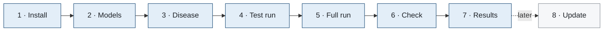

# Usage: build the knowledge graph of a disease

This guide takes you from a fresh clone to the knowledge graph of any disease in Open Targets: install, configure
the language models, add the disease, run, check and read the results. How each step works is in
[METHODS.md](METHODS.md); how to open the graphs already built is in the [README](../README.md).



**Contents**

1. [Install](#1-install)
2. [Configure the language models](#2-configure-the-language-models)
3. [Add a disease](#3-add-a-disease)
4. [Test run](#4-test-run)
5. [Full run](#5-full-run)
6. [Check the run](#6-check-the-run)
7. [Read the results](#7-read-the-results)
8. [Update, rebuild, change a rule](#8-update-rebuild-change-a-rule)
9. [Parameter reference](#9-parameter-reference)
10. [Troubleshooting](#10-troubleshooting)

## 1. Install

| Requirement | Version tested | Notes |
|---|---|---|
| Nextflow | 26.04 | needs Java 17 |
| Python | 3.12 | pandas, numpy, matplotlib, PyYAML, XlsxWriter, openpyxl ([requirements.txt](../requirements.txt)) |
| A language-model backend | — | the Claude Code CLI, the Anthropic API, or any OpenAI-compatible endpoint (section 2) |
| Internet access | — | Open Targets, NCBI, Europe PMC, Ensembl and the model backend, from the machine that launches the run |

With conda (recommended; installs Python, the packages, Java and Nextflow):

```bash
git clone https://github.com/ZhaoTie-re/DiseaseLens.git
cd DiseaseLens
conda env create -f environment.yml
conda activate diseaselens
```

Without conda: install Java 17 and [Nextflow](https://www.nextflow.io), then `pip install -r requirements.txt` in a
Python 3.10+ environment. Every process runs on the launching machine; no cluster is needed.

## 2. Configure the language models

DiseaseLens uses three language models, each with one role:

| Role | Does | Default (Claude Code CLI) |
|---|---|---|
| Reader A | reads every abstract and Methods section; writes the summaries | `claude-opus-5` |
| Reader B | reads the same texts independently; checks every summary claim by claim | `claude-sonnet-5-5` |
| Adjudicator | decides, item by item, where the readers disagree, seeing the record and both readings | `claude-opus-5-5` |

The models only read and write text. Every item they return is checked against its source text by rule, and only
items both readers agree on, or that the adjudicator decides, enter the graph ([METHODS.md](METHODS.md#8-the-genetic-studies-read-by-two-independent-models)).

**Set up.** Copy the template (git ignores the copy) and keep one of its three blocks:

```bash
cp conf/local.config.example conf/local.config
```

| You have | Block | Then |
|---|---|---|
| The [Claude Code](https://docs.anthropic.com/en/docs/claude-code) CLI, logged in | (1) `claude-cli` | nothing; `claude update` if it does not know a model |
| An Anthropic API key | (2) `anthropic` | `pip install anthropic`; `export ANTHROPIC_API_KEY=...` |
| An OpenAI-compatible endpoint (OpenAI, DeepSeek, vLLM, Ollama, ...) | (3) `openai`, with `base_url` | `export OPENAI_API_KEY=...` (a local server may need none) |

For example, block (3) with a local OpenAI-compatible server:

```groovy
params {
    llm = [
        readers    : [[name: 'A', provider: 'openai', model: 'model-a', base_url: 'http://localhost:8000/v1',
                       api_key_env: 'OPENAI_API_KEY'],
                      [name: 'B', provider: 'openai', model: 'model-b', base_url: 'http://localhost:8000/v1',
                       api_key_env: 'OPENAI_API_KEY']],
        adjudicator: [provider: 'openai', model: 'model-c', base_url: 'http://localhost:8000/v1',
                      api_key_env: 'OPENAI_API_KEY'],
        parallel   : 3,
    ]
}
```

**Rules.**
- **Three different models, each named.** The adjudicator decides between the readers, so it must be neither of them
  (the pipeline refuses the configuration otherwise). A named model keeps the run reproducible; a backend's default
  changes with its version. The two readers may come from different providers.
- **Keys** are read from the environment only. The configuration names the variable (`api_key_env`), never the key,
  and no key is written to any file the run makes.
- **Isolation.** The CLI backend runs with every customization off (no tools, MCP servers, memory or session files),
  in a scratch directory: no file or instruction of yours reaches the model. Logged in to a claude.ai account, the CLI
  adds the account's e-mail address to the model's context; any e-mail address not in the source text is removed
  from every answer before it is cached. The API backends send the prompt alone.
- **Python.** Set `python` in `conf/local.config` if the Python with the packages is not the first `python3` on your
  `PATH`.

**Cost and time** grow with the genetic literature of the disease. With three Claude models through the CLI, first
builds took: IPAH, 911 genetic-study records (336 read after the pre-screen) and 587 relation records, about US$60
and four hours; PVOD/PCH, about 190 records, about US$20. Every answer is cached as soon as it arrives
(`cache/llm/`), so a stopped run resumes without paying twice, and a later snapshot reads only new records.

Check the setup before the first run:

```bash
NO_LLM=1 ./verify.sh    # configuration, privacy and syntax; without NO_LLM it also tests isolation with one call
```

## 3. Add a disease

### 3.1 Find its Open Targets ID

Search the disease at [platform.opentargets.org](https://platform.opentargets.org) and copy its ID from the disease
page (EFO_, MONDO_, HP_ or Orphanet_). Always use the ID, never a name: a name can name several diseases.

### 3.2 Write the profile

```bash
python3 scripts/new_disease.py MONDO_0017148                   # writes diseases/hpah/profile.yaml
python3 scripts/new_disease.py <ID> --short ABC --key abc       # your own short name and folder name
```

The profile is written from the Open Targets record; each value carries the rule that chose it:

```yaml
id: MONDO_0017148            # the Open Targets disease ID (required)
name: 'heritable pulmonary arterial hypertension'     # its Open Targets name
short: 'HPAH'          # the shortest acronym among the exact synonyms in Open Targets that spells the name
pubmed:
  # the disease in title or abstract: its name, exact synonyms and short name
  #   acronyms: searched only beside a word of the name
  terms: '("heritable pulmonary arterial hypertension"[tiab] OR (HPAH[tiab] AND (heritable[tiab] OR ...)) OR ...)'
  # scope: <one or two sentences>
ontology:
  category: Disease group   # the category of the ontology neighbors in the products
```

| Field | Default | When to change it |
|---|---|---|
| `id` | — (required) | — |
| `name` | the Open Targets name | rarely |
| `short` | the shortest acronym among the exact synonyms; else the name (≤ 11 characters); else initials marked `# CHECK` | a made-up short name is only a label and is never searched: replace it with the abbreviation the literature uses |
| `pubmed.terms` | name, exact synonyms, short name, `evidence_also` names; the terms left out are listed with their reason | add a former name of the disease (HPAH: "familial primary pulmonary hypertension") so that older studies are found |
| `pubmed.scope` | none | for a subtype whose patients are often studied with others: one or two sentences on which studies count |
| `pubmed.query` | terms AND the genetic-study block of `config/search.yaml` | only to replace the whole genetic-study search |
| `relations.query` | terms AND relation designs AND relation words | only to replace the whole relation search |
| `evidence_also` | proposed for a grouping name ("A and/or B") | other Open Targets entries whose evidence counts as the disease's |
| `ontology` | `parents`, `siblings`, `children` on; `children_of: []`; `category: Disease group` | `children_of` adds the children of another disease (CTEPH: of pulmonary arterial hypertension) |
| `categories` | precursor / spectrum, risk factor, comorbidity, intermediate trait | categories of related conditions specific to the disease |
| `labels`, `abbreviations` | none | short labels for long condition names in figures and narrow columns |
| `checks` | none | expected values that `verify.sh` checks (for example `published_regions: 9`) |

**Before the first run,** read the profile: the short name, the terms and the terms left out. `diseases/hpah/`,
`diseases/ipah/` and `diseases/pvod_pch/` are profiles written from their ID; `diseases/cteph/` is fully curated.

### 3.3 Optional curated files

Each file in `diseases/<key>/` replaces or adds to a default. Start without them; add one when the defaults are not
enough.

| File | Replaces or adds | Use it when |
|---|---|---|
| `related_conditions.yaml` | replaces the clinical relations read from PubMed | you have a reviewed list of related conditions |
| `gwas_regions.yaml` | replaces the GWAS regions from Open Targets | a published GWAS table is better than what Open Targets holds |
| `gene_themes.yaml` | replaces Reactome pathways as gene functions | the disease has well-known gene groups |
| `curation.yaml` | adds curation entries | findings not about the disease itself; words text mining maps to the wrong gene |
| `choices.yaml` | adds to the choices registry | the basis and references of your curated files |
| `text/<product>.yaml` | adds prose to the products | disease-specific sentences (for example, how a published table is read) |

<details>
<summary><b>related_conditions.yaml</b>: a curated list of related conditions</summary>

Every quote is checked against its PubMed abstract at each build; the build stops if one is not found.

```yaml
version: '2026-10-16'
conditions:
- key: pulmonary_embolism
  name: Pulmonary embolism
  category: Precursor / spectrum          # one of the profile's categories
  ot_ids: [MONDO_0005279]                 # the Open Targets entry (none: a condition without genetics)
  genetics: full                          # full | coloc_only | none
  evidence:
  - pmid: '15163775'
    direction: increased risk             # increased risk | decreased risk | associated | no association found
    design: cohort
    population: Italy
    statement: CTEPH is a relatively common, serious complication of PE.
    quote: CTPH is a relatively common, serious complication of pulmonary embolism.
  east_asian: []                          # evidence from East Asian populations, in the same form
```
</details>

<details>
<summary><b>gwas_regions.yaml</b>: the regions of a published GWAS</summary>

`evidence` is a free label of each region; `codes` maps it to G (genome-wide significant) or G\* (significant only
in a secondary analysis).

```yaml
source:
  pmid: '38470220'
  table: Table 1. Genome-Wide Significant Regions for Chronic Thromboembolic Pulmonary Hypertension
  threshold: genome-wide significance, P < 5 x 10^-8
regions:
- {gene: ABO, genes: [ABO], chrom: '9', pos_grch37: 136137106, rsid: rs687289, maf: 0.340, or: 1.80, p: 6.8e-27,
   tier: 1, evidence: meta}
- {gene: F2, genes: [F2], chrom: '11', pos_grch37: 46349696, rsid: rs149903077, maf: 0.013, or: 3.30, p: 7.9e-8,
   tier: 3, evidence: pe}
codes: {meta: G, pe: 'G*'}
labels:
  G: Genome-wide significant in the CTEPH GWAS
  G*: Genome-wide significant only after leveraging PE
```
</details>

<details>
<summary><b>gene_themes.yaml</b>: gene functions with their basis</summary>

A gene belongs to the first theme that lists it; genes no theme lists join their Reactome top-level pathway.
`refs` names entries of the `references` of a choices file.

```yaml
themes:
- key: fibrinogen
  name: Fibrinogen
  short: Fibrinogen
  description: The three fibrinogen chains.
  basis: FGA, FGB and FGG encode the alpha, beta and gamma chains of fibrinogen (UniProt).
  refs: [uniprot]
  genes: [FGA, FGB, FGG]
```
</details>

<details>
<summary><b>curation.yaml</b>: findings not about the disease, and text-mining corrections</summary>

An entry that matches nothing stops the build, so that the file stays in step with the literature.

```yaml
findings:
  within_disease:                 # an outcome or phenotype among patients, not the disease itself
    items:
      - {pmid: '16936432', gene: ACE, match: 'independent predictors of survival', note: survival}
  other_trait: {items: []}        # another trait (for example, Mendelian randomization with the disease as exposure)
  functional: {items: []}         # a functional experiment
  background: {items: []}         # a background statement
text_mining:                      # words Europe PMC text mining maps to the wrong gene
  - {gene: SGCB, words: [sGC], meaning: soluble guanylate cyclase, example: '41154749'}
```
</details>

## 4. Test run

A smoke run reads the first 10 PubMed records only, into a separate folder: a few minutes and a few dozen model
calls.

```bash
nextflow run main.nf -c conf/local.config --diseases hpah --FetchDate $(date +%F) \
    --LlmLimit 10 --MaxThemes 2 --results_root results/_smoke
```

A disease can be named by its folder or by its ID (`--diseases MONDO_0017148`).

## 5. Full run

```bash
nextflow run main.nf -c conf/local.config --diseases hpah --FetchDate $(date +%F)            # one disease
nextflow run main.nf -c conf/local.config --diseases hpah,ipah --FetchDate $(date +%F)       # several
nextflow run main.nf -c conf/local.config -params-file projects/pulmonary_hypertension.yaml  # a project file
```

A project file lists the diseases of a run; an entry can give its own date or ask for a rebuild:

```yaml
diseases:
  - cteph
  - {key: hpah, fetch_date: '2026-10-19'}
  - {key: ipah, fetch_date: '2026-10-20', rebuild: true}
FetchDate: '2026-10-20'      # the date of every disease that names none
```

| Option | Effect |
|---|---|
| `--diseases a,b` | the diseases, by folder or ID |
| `--FetchDate YYYY-MM-DD` | the snapshot date: PubMed records that entered PubMed up to it; Open Targets as served on the day of the run |
| `-resume` | after a stop (an error, a network failure, a usage limit), continue where the run stopped |
| `--LlmOffline true` | cached model answers only; no model is called |
| `--Rebuild true` or `--Rebuild key` | re-derive the snapshot of that date from its saved sources (section 8) |
| `--results_root <dir>` | write elsewhere than `results/` |

Long runs survive a closed terminal when started with `nohup` or inside `tmux` / `screen`.

## 6. Check the run

```bash
./verify.sh                      # every disease: configuration, privacy, and the checks of each snapshot
DISEASES=hpah ./verify.sh        # one disease
```

`verify.sh` is read-only. Sections 1–6 check the source tree, the configuration of every disease, privacy and model
isolation; sections 7–11 check the newest snapshot of each disease: run records, tables and evidence, figures and
knowledge base, workbooks, graph, viewer and index. Other options: `NO_LLM=1` (no model call), `NO_NET=1` (no
network), `RESULTS=<dir>` (another results folder), `SNAP=<date>` (another snapshot).

## 7. Read the results

```text
results/
├── index.html                    every disease, with links to its products
├── index.json, README.md
└── <key>/
    ├── latest.json               the disease's newest snapshot and the path of each product
    └── snapshots/<date>/
        ├── README.md                         the snapshot: where to start, headline counts
        ├── <key>_knowledge_graph.html        the viewer (one offline HTML file)
        ├── <key>_knowledge_graph_<date>.xlsx            the workbook
        ├── <key>_knowledge_graph_<date>_summary.xlsx    the workbook without the appendix
        ├── 00.raw/  00.pubmed/   sources, as fetched
        ├── 01.relations/  01.conditions/   related conditions and their evidence
        ├── 02.literature/        the genetic studies, as read
        ├── 03.curated/           the curation, with its log and the disputed model readings
        ├── 04.tables/            long tables, GWAS regions, the evidence ladder
        ├── 05.graph/             nodes and edges (TSV), graph.json, SQLite, schema
        ├── 06.summaries/  07.changes/
        ├── 08.knowledge/         the knowledge base (Markdown, JSON)
        ├── 09.figures/           figures (PNG, PDF) and their catalog
        └── _run_info/            the resolved profile and the run manifest
```

| To | Open |
|---|---|
| browse the graph | `<key>_knowledge_graph.html`, in any browser, offline; "How it is built" explains every rule as applied to the disease |
| read the evidence by question | the workbook; the summary workbook to send |
| read the knowledge base with figures | `08.knowledge/<key>_knowledge_graph.md`, `09.figures/` |
| see what the two models disagreed on, and the decision | `03.curated/model_review.tsv`; the workbook's curation sheet |
| see every curation rule applied | `03.curated/curation_log.tsv` |
| query from the shell or Python | `python3 scripts/kg.py --disease <key> ...` (see the [README](../README.md#query-the-graph)) |

**The workbook** answers one question per sheet:

| Part | Sheet | Question |
|---|---|---|
| | Guide | the disease, the answers in brief, how to read, the sources and their versions, the readers and their agreement |
| A · Genetics of the disease | 1 genes at a glance | Which genes have genetic evidence, how strong is it, and what do they do? |
| | 2 gene evidence | What does each study report for each gene? |
| | 3 genetic studies | Which genetic studies are there, and how were they done? |
| B · Related conditions | 4 related conditions | Which conditions are related, and on what evidence? |
| | 5 shared GWAS regions | Which GWAS regions do related conditions share? |
| | 6 shared genes | Which genes do the disease and its related conditions share? |
| | 7 condition genetics | What are the genetics of each related condition? |
| C · Context | 8 mechanisms | Which mechanisms does the literature describe? |
| | 9 East Asian | What evidence comes from East Asian and Japanese populations? |
| D · Provenance | 10 curation | What was left out or corrected, and why; what did the readers disagree on? |
| | 11 choices and basis | On what basis was each value chosen? |
| | 12 changes | What changed since the previous snapshot? |
| Appendix | A1–A6 | flat tables with filters (full workbook only) |

Each sheet opens with its answer in brief, then a nested table: open a row with + at the left, or a whole level with
the buttons 1 2 3. Source passages are in cell notes; every row links to its source.

## 8. Update, rebuild, change a rule

- **A later snapshot.** Run again with a new `--FetchDate`. Sources are read again; only new or changed records go
  to the models; the snapshot is compared with the previous one (`07.changes/`, workbook sheet 12).
- **Change a rule.** Thresholds are parameters (section 9): set them on the command line or in a project file. Shared
  lists are in `config/` (`search.yaml`: PubMed blocks and the pre-screen; `curation.yaml`: curation rules;
  `choices.yaml`: the registry). A disease's own entries go into its folder. Every product shows the values of its
  run.
- **Rebuild a snapshot** after a change of rule, without reading the sources again:
  `--Rebuild true --FetchDate <the snapshot's date>`. A rebuild does not re-derive the related conditions; a change to
  the relation rules takes a new snapshot.

## 9. Parameter reference

Set any parameter with `--Name value`, in a project file, or in `conf/local.config`.

| Parameter | Default | Meaning |
|---|---|---|
| `diseases` | — | diseases of the run (folders or IDs) |
| `FetchDate` | — | snapshot date, YYYY-MM-DD |
| `Rebuild` | `false` | `true` or disease keys: re-derive from saved sources |
| `results_root` | `results` | where snapshots are written |
| `python` | `python3` | Python with the packages of requirements.txt |
| `llm` | three Claude models via the CLI | readers, adjudicator, `parallel` (calls at a time per reader, 3), `timeout` (600 s) |
| `LlmOffline` | `false` | cached answers only |
| `LlmBatch` | `5` | abstracts per reading call |
| `LlmLimit` | `0` | smoke run: the first N PubMed records only (0 = all) |
| `MaxThemes` | `0` | smoke run: the N largest mechanism themes only (0 = all) |
| `Prescreen` | `true` | drop reviews and records without a genetic-study term before the models read |
| `GenomeWideP` | `5e-8` | lead P of a GWAS region from Open Targets |
| `RegionMinMac` | `25` | expected minor-allele copies of a lead in the smaller group |
| `RegionMinMaf` | `0.01` | below this frequency, a lead needs P < `RareVariantP` |
| `RareVariantP` | `5e-9` | P of a rare lead |
| `RegionWindowKb` | `500` | credible sets this close form one region |
| `L2gMin` | `0.5` | top locus-to-gene score for a gene–condition link and a region name |
| `MendelianMin` | `0.5` | datasource score of curated gene evidence |
| `ClppMin` | `0.01` | colocalization (eCAVIAR CLPP), and the PIP of a lead-variant overlap |
| `H4Min` | `0.8` | colocalization (coloc H4) |
| `EasMin` | `0.5` | East Asian share of a GWAS sample to flag it |
| `MaxGwasStudies` | `100` | a related condition with more GWAS keeps its shared signals only |
| `MaxOntologyChildren` | `30` | a parent with more children is too broad to give neighbors |
| `ThemeTargets` | `12` | targets whose sentences feed a mechanism summary |
| `MinThemeTargets` | `3` | smallest theme that gets a summary |
| `SentencesPerPaper` | `3` | sentences kept per text-mined publication |

## 10. Troubleshooting

| Symptom | Cause, and what to do |
|---|---|
| the run stops at a model account's usage limit | wait for the limit to reset, then run the same command with `-resume` |
| `two readers need an adjudicator` | name a third model in `llm.adjudicator` |
| a model name the CLI does not know | `claude update` |
| `no short name: give short` | the name is long and has no acronym among its synonyms: `new_disease.py <ID> --short ABC`, or set `short` |
| `WARNING: the query finds no record` | the terms find nothing in PubMed: add the names the literature uses to `pubmed.terms` |
| `PubMed reports an error for the query` | a malformed term in `pubmed.terms` or `pubmed.query` |
| `curation items that match no finding (stale config)` | an entry of the disease's `curation.yaml` no longer matches the literature: read it against the new snapshot, then edit or remove it |
| `Open Targets serves <release>, the snapshot is <release>` | a rebuild needs the release of its snapshot; build a new snapshot instead |
| `no diseases/<key>/profile.yaml` | write the profile first (section 3) |
